# small-nodejs-service: detailed documentation

This is the detailed companion of the [project README](README.md). The project README explains what the project is, what it brings, and the ideas behind it. This document has the details: the domain model and access rules, the security model, the design decisions, both data modes with configuration, the sizing guide, local development, authentication, the API with examples, and a code map.

## Contents

- [How a request flows](#how-a-request-flows)
- [Domain model](#domain-model)
- [Who can see what](#who-can-see-what)
- [The Portal School](#the-portal-school)
- [Statuses, change tracking and deletion](#statuses-change-tracking-and-deletion)
- [Security model](#security-model)
- [Design principles](#design-principles)
- [Design decisions](#design-decisions)
- [Design guarantees and caveats](#design-guarantees-and-caveats)
- [Data modes: joins or notifications](#data-modes-joins-or-notifications)
- [Sizing guide](#sizing-guide)
- [Local development](#local-development)
- [Authentication](#authentication)
- [API conventions](#api-conventions)
- [Walkthrough: from a new school to a schedule](#walkthrough-from-a-new-school-to-a-schedule)
- [Services and examples](#services-and-examples)
- [Code map](#code-map)

## How a request flows

Every request goes through the same checks before it reaches a controller. The backend is authoritative: the UI hides what a user cannot do, but it never decides.

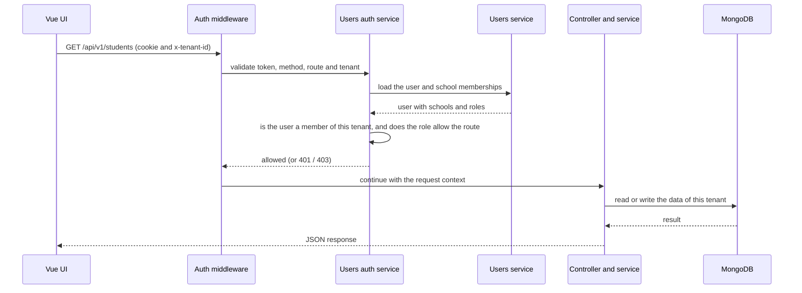

1. **Token:** the browser sends the HttpOnly cookie automatically. The token proves who the user is.
2. **Tenant:** `x-tenant-id` says which school the request is for. The user must be a member of it.
3. **Route and role:** `config.roles.json` lists which roles may call which route. The role is the one the user has _in that school_.
4. **Context:** the controller receives the resolved user and tenant as `req._ctx`, and services use it to pick the tenant's data.

## Domain model

**Users are global, roles belong to a school membership.** A user is one identity. The list of schools they belong to, and their roles in each, is stored on the user.

| Concept                   | Scope      | What it is                                                                        |
| ------------------------- | ---------- | --------------------------------------------------------------------------------- |
| User                      | global     | A person: name, email, status, and the list of school memberships                 |
| School                    | global     | A tenant. Has a name, description, and a status (`pending`, `active`, `disabled`) |
| Admin, Professor, Student | one school | The school record of a user with that role. It points to the user                 |
| Class                     | one school | A subject, for example "Mathematics 1A"                                           |
| Location                  | one school | A room, with an address                                                           |
| Group                     | one school | A set of students                                                                 |
| Schedule                  | one school | When a class takes place: its professors, groups, students, times, and locations  |

**People and schools.** A user joins schools through memberships. Admin, professor, and student records are the school's record of a user.

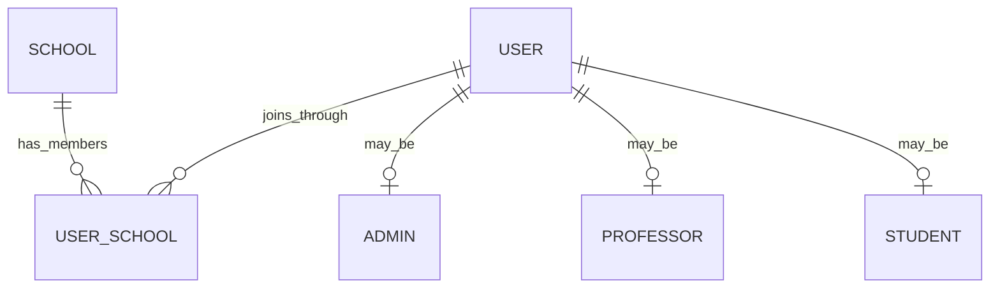

**What a school holds.** Four kinds of records belong to a school.

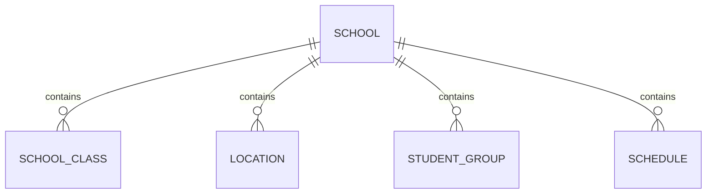

**A schedule.** It points to a class, professors, groups, and students, and has time slots that each point to a location. A group points to its students.

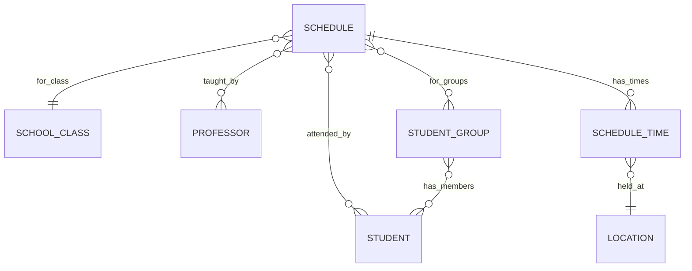

`USER_SCHOOL` and `SCHEDULE_TIME` are not collections: they are the school memberships stored inside the user, and the list of times stored inside the schedule. `SCHOOL_CLASS` and `STUDENT_GROUP` are the class and group records. The diagrams do not call them `CLASS` or `GROUP` because `CLASS` is a reserved word in Mermaid's ER diagrams and stops GitHub from rendering them.

### Memberships and roles

This is what the user record looks like. The same person is `admin` in one school and `professor` and `student` in another:

```jsonc
{
  "id": "user-1",
  "email": "ada@example.test",
  "name": "Ada Lovelace",
  "schools": [
    { "id": "school-north", "name": "North School", "status": "active", "roles": ["admin"] },
    { "id": "school-south", "name": "South School", "status": "active", "roles": ["professor", "student"] }
  ]
}
```

After login the UI shows the active schools. The school the user picks becomes `x-tenant-id`, and from then on only the roles of that school count.

| Role           | Where             | What it can do                                                                                                                                    |
| -------------- | ----------------- | ------------------------------------------------------------------------------------------------------------------------------------------------- |
| `admin`        | a school          | Everything inside the school: manage classes, locations, groups, schedules, admins, professors, and students; invite users; manage the own school |
| `professor`    | a school          | Read the school data: classes, locations, schedules, groups, and the lists of professors and students                                             |
| `student`      | a school          | The same read-only access as a professor                                                                                                          |
| `portal-admin` | the Portal School | Runs the portal: creates schools and manages the other portal admins (next section)                                                               |

**What a member sees of its school** (the roles permissions, `src/services/roles.permissions.js`). The role matrix allows a route; the lists and the details then show only what concerns the caller, by its roles in the school of the request (an admin sees everything; a member that is both a professor and a student sees what each role sees):

| Caller    | Students                                                   | Professors                      | Groups                      | Schedules                                          |
| --------- | ---------------------------------------------------------- | ------------------------------- | --------------------------- | -------------------------------------------------- |
| Admin     | all                                                        | all                             | all                         | all                                                |
| Professor | the students of its schedules (listed, or in their groups) | only itself                     | the groups of its schedules | the ones where it is listed                        |
| Student   | only itself                                                | the professors of its schedules | its groups                  | the ones where it, or one of its groups, is listed |

A group or a schedule that the caller does not see answers `404` (as one that does not exist). In a group or a schedule, a student sees the other students only when the school setting `classmates` is `show` (the default); with `hide` it sees only itself. A call of another service is not restricted.

On top of the role, some routes use the special rule **current user**: any member can work with **their own** user record (and their own student or professor record), because the id in the path must match the logged-in user. This is how a student edits their own profile without being an admin. The current user routes also work **without a school**: a user whose roles were all removed logs in to the school selection, which says that it is not a member of any school, and can still change its profile, its email and its password, or delete its account. Such a route uses the selected school only if the user is a member of it; otherwise the school of the request is ignored.

Admins add and remove people **by their roles**: a school admin adds a role with an invitation and removes it with `PATCH /users-auth/school/user/:uid` (or the delete of the person on its page), and a portal admin does the same for the admins of a school and for the portal admins. This changes only the roles of the user in that school; the account and the other schools are not touched. Only the user changes its own email.

The exact routes of each role are in `src/services/config.roles.json`. A route not listed for a role is refused (`403`; `401` when the user is not a member of the tenant).

## Who can see what

The access model is built around the idea that **everybody sees the minimum they need**.

| Who          | Sees                                                                                                                                                                                                                                                                                                                                                                                                                                      |
| ------------ | ----------------------------------------------------------------------------------------------------------------------------------------------------------------------------------------------------------------------------------------------------------------------------------------------------------------------------------------------------------------------------------------------------------------------------------------- |
| Portal admin | The list of schools, the admins of each school, the portal admins, all the users (name, email and status only, not their schools), and the global events (logins and password changes, which belong to no school). **Nothing inside a school**: not its students, groups, classes, locations, schedules, or events. A portal admin is not a member of the schools, so a request for a school's data with that school as tenant is refused |
| School admin | Everything inside their own school, and nothing of any other school                                                                                                                                                                                                                                                                                                                                                                       |
| Professor    | The school data they need to teach: classes, locations, schedules, groups, and the people lists                                                                                                                                                                                                                                                                                                                                           |
| Student      | The school data they need to attend: classes, locations, schedules, groups                                                                                                                                                                                                                                                                                                                                                                |
| Any member   | Their own profile (`current-user` rule)                                                                                                                                                                                                                                                                                                                                                                                                   |

> **Design intent and current matrix.** The intent is that a student sees only minimal details and mostly nothing about other students, and that a professor sees the list of their own students. Today `config.roles.json` gives professors and students the same read access (including the people lists). Narrowing it is a change to that file plus the services' filters, not a new mechanism.

## The Portal School

The portal needs somewhere to keep its own administrators. Instead of a special case, that place is **a school like the others**: the Portal School.

- Users select it after login, like any other school.
- Inviting a user to it makes that user a **portal admin** (the `portal-admin` role).
- Its id is configured only on the backend (`SMALL_API_PORTAL_SCHOOL_ID`). It is never part of the UI source.
- It always stays active, it cannot be deleted, and it is **not** listed with the managed schools.

Two rules keep it separate from the normal schools, and the backend enforces both:

1. `portal-admin` can only be given on the Portal School.
2. Nothing but `portal-admin` can be given on the Portal School.

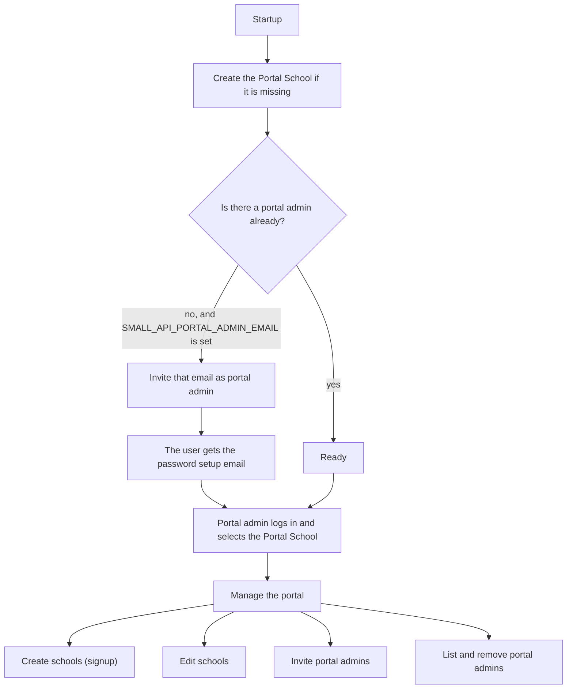

| Action                      | Route                                                          | Who can do it                                                                                         |
| --------------------------- | -------------------------------------------------------------- | ----------------------------------------------------------------------------------------------------- |
| Create a school             | `POST /users-auth/signup`                                      | Portal admin (it invites the first admin of the new school)                                           |
| List managed schools        | `GET /schools`                                                 | Portal admin                                                                                          |
| Edit a school               | `PUT` or `PATCH /schools/:id`                                  | Portal admin; a school admin for their own school                                                     |
| Invite a portal admin       | `POST /users-auth/invite` with role `portal-admin`             | Portal admin                                                                                          |
| List portal admins          | `GET /users/portal-admins`                                     | Portal admin                                                                                          |
| List the admins of a school | `GET /users/school-admins/:schoolId`                           | Portal admin                                                                                          |
| Remove a portal admin       | `PATCH /users-auth/school/user/:uid` (remove the role)         | Portal admin, also for their own role                                                                 |
| Invite an admin of a school | `POST /users-auth/invite` with `school.id` and role `admin`    | Portal admin; a school admin invites into their own school without `school.id`                        |
| Remove an admin of a school | `DELETE /users/school-admins/:schoolId/:id` (removes the role) | Portal admin. All the admins of a school can be removed; a new one can be invited                     |
| List all users              | `GET /users`                                                   | Portal admin (name, email, status)                                                                    |
| Change the name of a user   | `PUT` or `PATCH /users/:id`                                    | The user; a school admin for its members; a portal admin (the name only)                              |
| Change the status of a user | `PUT` or `PATCH /users/:id/status`                             | Portal admin (not for their own account). `pending` -> `active` / `disabled`, never back to `pending` |
| Read the global events      | `GET /events/global`, `GET /events/global/:id`                 | Portal admin. The events of a school (`GET /events`) are read by its admins                           |

A portal admin can remove another portal admin and also their own role, and a school can be left without admins: a portal admin can invite a new one at any time. Removing the role keeps the user account.

**The first portal admin.** Set `SMALL_API_PORTAL_ADMIN_EMAIL` and the start invites that address through the normal invite flow. The person receives the password setup email, so no password is ever stored in the configuration. It does nothing while an active portal admin exists, so it is safe on every restart; when there is none (never used, all removed, or only disabled ones), every start invites the configured address again, with a new setup link. If the email can not be sent, the log says so and names the mail settings. There is deliberately no public portal-admin signup.

In the UI, the Schools page has two lists: the **portal admins** and the **managed schools**. The Portal School itself is not shown, because it is always the same: the portal admins list has a **+** to invite a new portal admin and a delete action to remove one. Each managed school can be expanded to show its admins.

## Statuses, change tracking and deletion

### Status controls what is in use

Records that can be switched on and off carry a `status`: `pending`, `active`, `disabled`. It is used to **control what is current without deleting anything**. A typical use is a school year: every year the school creates new groups and schedules and sets the old ones to `disabled`. The old data stays for history and reports, and the lists, selectors, and schedules of the new year only show what is active.

| Record                           | Statuses                                                                                                               |
| -------------------------------- | ---------------------------------------------------------------------------------------------------------------------- |
| School                           | `pending` until its first admin logs in, then `active`; `disabled` hides it from the tenant selector and blocks access |
| User                             | `pending` until the first login, then `active`; `disabled` blocks login (a deleted account is deleted)                 |
| Class, location, group, schedule | `pending`, `active`, `disabled` (default `pending` on creation)                                                        |
| Admin, professor, student record | its referenced user (`user.status`): the user's status while it has the role; `removed` or `deleted` for a trace       |

**Pending records expire.** A pending user (an invitation that was not used) and a pending school (a signup that was not followed by a login) are removed `SMALL_API_PENDING_EXPIRES_IN` seconds after they were created (72 hours by default, as long as the invitation link). The users and schools services check every hour, or as often as the expiry when it is shorter (with `600`, every 10 minutes), starting one interval after the start; the start logs the expiry and the interval in use; a MongoDB TTL index is not used, because it would delete without the events and the notifications that clean the other services. The removals are in the events of the Portal School, done by the user `cleanup pending` (the events of the start are done by `setup`, and those of a public form, like a password reset, by `anonymous`: an event always names who did it). A pending portal admin expires too: while no portal admin is active, every start invites the configured one again.

### Every record tracks its changes

Every document in the database has:

| Field                   | Meaning                                                     |
| ----------------------- | ----------------------------------------------------------- |
| `createdTimestamp`      | when the record was created                                 |
| `lastModifiedTimestamp` | when it was last changed                                    |
| `modifiedCount`         | a counter, starts at `1` and is incremented on every change |

The counter is how a consumer can tell **which version of a record it has seen**. It is the basis for ordering asynchronous updates: services update each other's referenced objects through notifications, and the order in which two changes arrive is not guaranteed, so a referenced object that carries a counter can be compared with the change that arrives.

### Deleting a user keeps the traces

A user can delete their own account (the profile page, `DELETE /users-auth`). The account is deleted: the user record, its login, its sessions and its links. Each school decides what happens to the records the person leaves.

The person's **traces stay in the schools** (by default): the admin, professor, and student records, with their entries in groups and schedules, and the events that name them, remain; their referenced user is marked `deleted` (`user.status`). History such as who taught a class or attended a schedule is not rewritten. An admin removes a person from their school by removing the role, which does not delete the account; the record stays, its referenced user marked `removed`. A person who never logged in (pending) leaves nothing.

Two kinds of schools show why this is a setting:

- **A university keeps the traces.** A student is part of new groups and new schedules every year, with new professors, classes that end, and grades. When a student or a professor leaves, the past groups, schedules, and grades must still show who was there.
- **A sports gym deletes them.** Someone joins a training group and a schedule; when they leave, nothing about them is needed anymore: the record is deleted, with its entries in the groups and the schedules.

Each school chooses on its **Settings** page (`GET|PUT /schools/:id/settings`, its admins: one line with the current choice, changed in a dialog with a checkbox) what happens to a removed person:

| Setting `removedMembers` | What happens to the admin, professor, or student record                                                                                                                      |
| ------------------------ | ---------------------------------------------------------------------------------------------------------------------------------------------------------------------------- |
| `keep` (default)         | kept, its referenced user marked `removed` (role removed) or `deleted` (account deleted); it stays in the lists, groups and schedules. Deleting it from its list removes it  |
| `delete`                 | deleted, and removed from its groups and schedules (the notifications follow). Nothing is kept; it can not be undone                                                         |

**Rejoining.** A deleted user invited again is a new user, with a new id, like any other. The invite is the only way into a school, so it links the person to its traces there, once: before the user gets its role, the school's admin, professor, and student records of a deleted account with the same email take the id of the user (where they are referenced, in the groups and the schedules, the id follows), whatever the role of the invite. A trace stays `deleted` until its user has that role again and is active: the role given again makes its record active again at the first login (or at once, when the user is already active in another school), and the others stay traces (for example the professor record stays `deleted`). An invitation that is not used in time removes the user again, and the traces stay `deleted`.

**Emails.** An email of the same kind (an invitation, a setup link, a reset link) is sent to a person at most once a minute: a repeated click or a flood of the public form sends nothing more, and the link sent first stays the valid one. The emails are sent without waiting for the mail server; a failed delivery is logged, and inviting again later sends it again.

**No accidental delete.** In the UI the delete buttons of a list are hidden until its "Show delete" icon is chosen (in the header of the actions column, or next to the "+" of an inner list), and the profile shows "Delete my account" only after "Show delete", below the profile; every delete is then confirmed.

## Security model

Security is the first design constraint, not a layer added at the end. The model is **zero trust**: no request is trusted because of where it comes from, what the UI shows, or what an earlier request proved.

### Layers

| Layer              | What it does                                                                                                                                                                                                                                                             |
| ------------------ | ------------------------------------------------------------------------------------------------------------------------------------------------------------------------------------------------------------------------------------------------------------------------ |
| Transport          | CORS allow-list with credentials, security headers, HTTPS redirect in production, an `Origin` check that blocks cross-site requests (CSRF)                                                                                                                               |
| Authentication     | A signed and encrypted token in an **HttpOnly cookie**. The browser sends it; JavaScript cannot read it, and the UI does not store it. Login is rate limited                                                                                                             |
| Authorization      | Every request, on every route: token, then the user's membership of the tenant in `x-tenant-id`, then the role's permission for the route in `config.roles.json`. The check is repeated on every call, never cached in the client                                        |
| Tenant isolation   | Each school's data lives in its own collections, selected from the tenant in the verified context, not from anything the client chooses freely                                                                                                                           |
| Service to service | Services call each other through REST wrappers. Between processes a call carries a signed service token, the request context, and the API URL as `Origin`; a route takes the token instead of a cookie. Internal routes are never part of the public API                 |
| Input              | Every body is validated with Joi; unknown fields are rejected; list filters accept only the fields a service declares; query operators such as `$where` are refused                                                                                                      |
| Errors             | In production responses carry no stack traces                                                                                                                                                                                                                            |
| UI                 | Permission checks in the UI only hide and guard for convenience; the API decides. No `v-html`, no token in storage                                                                                                                                                       |

### Rules about people

- **Only admins invite.** A school admin invites into their own school. A portal admin invites portal admins. There is no public signup: a school is created by a portal admin, who invites its first admin.
- **Roles belong to a school membership**, not to the user. `portal-admin` exists only on the Portal School, and nothing else can be given there. These two rules are checked when inviting and when changing roles.
- **A portal admin cannot see school details** (see [Who can see what](#who-can-see-what)).
- **Admins cannot remove their own admin role**, which is meant to keep a school from ending up without an admin.
- **The Portal School's id is backend configuration only.** It is never part of the UI source or its environment.
- **No anonymous bootstrap.** The first portal admin comes from an environment variable at startup, through the normal invite flow, so no password is configured anywhere.

### Checks that were run and held

Independent security, adversarial, flow, concurrency, and scalability reviews were run against the project. Behaviour that was attacked and held:

- A student or professor was refused on all 20 admin and portal routes tried.
- An admin of school A using the tenant of school B, a portal admin using a normal school as tenant, and missing, garbage, lower-case, or duplicated `x-tenant-id` values were all refused.
- A school admin cannot invite into the Portal School or grant or remove `portal-admin`. The Portal School cannot be disabled, set to pending, or deleted through any route, and it is not in the managed schools list.
- The route matrix matches the registered routers exactly, and route-order shadowing (for example `/users/portal-admins` against `/users/:id`) is handled.
- The internal routes return `401` without a valid service token.
- Path tricks (case changes, double or trailing slashes, encoded characters, HEAD and OPTIONS) never allowed a forbidden action.
- Operators and unknown fields in queries and bodies are rejected on public routes.

## Design principles

| Principle                | What it means                                                                                                                                                                                                                                                                  |
| ------------------------ | ------------------------------------------------------------------------------------------------------------------------------------------------------------------------------------------------------------------------------------------------------------------------------ |
| Tenant context           | Tenant requests carry the school in `x-tenant-id`. The middleware checks the membership once; services receive the resolved context and use it to pick the tenant's data                                                                                                       |
| Authorization in the API | `config.roles.json` maps routes to roles. The UI hides and guards for convenience only                                                                                                                                                                                         |
| Layers                   | Router (routes) → controller (HTTP) → service (validation and rules) → database module (collections and indexes). Other services are reached through `src/services/rest/` wrappers                                                                                             |
| Shared helpers           | Joi schemas for input, `RestApiUtils` for list filters, `DbOpsUtils` for MongoDB, reference utilities for related records                                                                                                                                                      |
| Events and notifications | A successful change made through a public route raises an event, which names who did it, and a notification. Subscribers update their referenced objects. Notification routes are internal. See [Data modes](#data-modes-joins-or-notifications)                               |
| Internal calls           | Services call each other through `RestCommsUtils`: a direct call in the same process, or a REST call with a service token (an internal route, or a public one: the token replaces the cookie); the options of a read (the primary) go with the call                            |
| Status lifecycle         | `pending`, `active`, `disabled`. The first login activates a pending user and school, also a refresh of the session (`GET /users-auth/me`) for a school added after the login; neither goes back to `pending`. The tenant selector offers only active schools                  |
| Translations and email   | Response fields are translated by the translation utilities. Strings and email templates are in `src/translations/`                                                                                                                                                            |
| Cookie authentication    | The browser sends the HttpOnly cookie. Never put the token into a JavaScript `Authorization` header                                                                                                                                                                            |
| Transport and abuse      | CORS allow-list with credentials, security headers, HTTPS redirect in production, and a login limit of three attempts per IP per 15 minutes (outside debug mode); a call of another service is not limited                                                                     |
| Password policy          | At least eight characters with uppercase, lowercase, a digit, and a special character. Changing the password or the email needs the current password                                                                                                                           |
| Tests                    | Mocha with Sinon stubs, one suite per service in `src/test/test/`. Database-backed tests are separate (`npm run testdb`)                                                                                                                                                       |

## Design decisions

| Decision                                                                        | Why                                                                                                                                         | What it costs                                                                                  |
| ------------------------------------------------------------------------------- | ------------------------------------------------------------------------------------------------------------------------------------------- | ---------------------------------------------------------------------------------------------- |
| **Every school is a tenant, including the Portal School**                       | One access model for everything: the portal admin is just a membership with a special role, not a separate login system                     | Two small invariants to enforce (`portal-admin` only on the Portal School, nothing else there) |
| **Users are global; roles live on the school membership**                       | One person can be a professor in one school and a student in another                                                                        | The user record carries a list of memberships that must be kept current                        |
| **References are embedded in the document** (the fields a list shows)           | List requests are one read of one collection. The referenced objects can be filtered and sorted in the database, for example by `user.name` | Writes do more work, and referenced objects must be kept current                               |
| **Two data modes, chosen per reference**                                        | Read-heavy data is embedded; data that changes as often as it is read is joined                                                             | Two code paths to understand; see [Data modes](#data-modes-joins-or-notifications)             |
| **Synchronous, in-process notifications**                                       | Simple, ordered by the call, no extra infrastructure. `broadcast` and `consume` are in place for durable, asynchronous delivery             | A failed object is logged and not retried, so referenced objects are eventually consistent     |
| **Services run in one process or many**                                         | The same code uses direct local calls in one process and REST between processes. Start simple, split later                                  | The REST wrappers are the only allowed way to cross a service boundary                         |
| **Per-school collections**                                                      | Isolation by construction, and a school's data is easy to find and remove                                                                   | About 8 collections and 35 indexes per school; it cannot be sharded by tenant as is            |
| **Statuses instead of deleting**                                                | Yearly archiving, history, and reversible changes                                                                                           | Lists must filter by status                                                                    |
| **Only admins invite, no public signup**                                        | Closed system for schools: nobody joins unless a responsible person adds them                                                               | An admin must always exist (see the rules about people)                                        |
| **HttpOnly cookie, not a token in JavaScript**                                  | A script injected into the page cannot steal the session                                                                                    | Needs correct CORS and cookie settings when the UI and API are on different origins            |
| **Not a queue for every call**                                                  | Login and token checks are latency-sensitive and cost the same CPU in any design; a job per call adds writes, polling, and a hot collection | Background work is queued instead (see [Sizing guide](#sizing-guide))                          |
| **A deleted user leaves traces**                                                | School history stays correct                                                                                                                | Person records stay, marked `deleted`                                                          |

## Design guarantees and caveats

Each guarantee, with the check that proves it, is listed in [README.design-invariants.md](README.design-invariants.md).

### Guarantees

What the design promises and what has been checked to hold, by attacking it and by tracing the code. These are the promises later changes must keep.

| Area              | Guarantee                                                                                                                                                                                                                                                                                                                                                                                                             |
| ----------------- | --------------------------------------------------------------------------------------------------------------------------------------------------------------------------------------------------------------------------------------------------------------------------------------------------------------------------------------------------------------------------------------------------------------------- |
| Tenants           | A person reaches a school's data only as a member of that school, with a role the route allows. A request with another school's tenant is refused                                                                                                                                                                                                                                                                     |
| Routes            | Every public route is in the role matrix or in the short public list, and the matrix has no entry without a route. An unknown route and method pair is denied. A specific route is never handled as a parameter route, and the authorization check runs once per request                                                                                                                                              |
| The portal        | A portal admin sees the list of schools, the admins of each school, the portal admins, all the users (without their schools) and the global events, and nothing inside a school                                                                                                                                                                                                                                       |
| Roles             | `portal-admin` can be given only on the Portal School, and nothing else can be given there. A school admin cannot remove their own admin role; a portal admin can, and the configured portal admin is invited again at the next start when none is active                                                                                                                                                             |
| Invitations       | Only admins invite. There is no public signup                                                                                                                                                                                                                                                                                                                                                                         |
| The Portal School | It cannot be disabled, set to pending, or deleted through any route, it is not in the managed schools list, and its id never reaches the UI                                                                                                                                                                                                                                                                           |
| Statuses          | A disabled or deleted user is refused at login and on every request. A disabled school is refused as a tenant and is never re-enabled by a login or a refresh. The status of a deleted account is never changed by a portal admin, and no role is added to it without a new invitation                                                                                                                                |
| Session           | The token lives only in an HttpOnly cookie, never in a response body or in UI storage. Cross-site requests are rejected. Production errors carry no stack traces                                                                                                                                                                                                                                                      |
| Internal calls    | Internal routes need a valid service token; a missing, wrong, session, or old token is refused. On a public route a valid service token replaces the cookie. The token carries the options of the read of the calling service, so only a service can ask the primary                                                                                                                                                  |
| Input             | Bodies are validated against a schema, unknown fields are rejected, list filters accept only declared fields, query operators are refused, and the page size is capped                                                                                                                                                                                                                                                |
| Change tracking   | Every record has `createdTimestamp`, `lastModifiedTimestamp`, and a `modifiedCount` incremented on every change                                                                                                                                                                                                                                                                                                       |
| References        | When a record changes, it is updated where other services reference it, and where those objects are referenced in turn. A referenced object is updated only when it is older than the change (`modifiedCount`, and `createdTimestamp` for a record created again with the same id; the write checks it too), so a late, repeated, or racing notification, or one that comes back through a cycle, changes nothing     |
| Reads             | A request sees its own writes: the object of a write is its answer, never read again. The reads that decide a write (after a write that returns no object, in a notification, of a reference, a login, an invite, a role change) ask the primary. A request that changes data is authorized on the primary; a read request on a secondary, and a refusal there is checked on the primary                              |
| People            | Removing a role touches only that school's record. Deleting a user keeps the school records and events, their referenced user marked deleted, unless the school chose to delete them. Only the user changes its email                                                                                                                                                                                                 |
| Concurrency       | Two concurrent requests do not create two users, two auth records, or two Portal Schools, and two concurrent role grants do not create two memberships or a duplicate role (the unique indexes must exist)                                                                                                                                                                                                            |
| Startup           | The Portal School is created once; a restart changes nothing. A bad configuration (a Portal School id that is not a UUID, an invalid first-admin email, a Portal School that is not active) stops the start with a clear message                                                                                                                                                                                      |
| Cost              | Nothing in the request path fans out without a bound. Notification delivery is one update per changed record and reference                                                                                                                                                                                                                                                                                            |
| Database          | A request waits a bounded time for a database connection (30 seconds by default) and a database call runs a bounded time (30 seconds by default, then the database stops it); after either it answers `503`. Each process opens a bounded number of connections to each member of the replica set (16 by default). All three are set with `SMALL_API_DATABASE_LIMITS`                                                 |
| The UI            | An action sends one call, also on a double click. A dialog closes when its call starts; the button that opened it is disabled until the answer, with a spinner when the call takes longer than 300 ms, and the snackbar tells the result. A list or a details panel shows only the answer of its latest call, and a refused request shows its reason                                                                  |

### Caveats

Limits that are part of the design. They are written here so that nobody is surprised.

| Caveat                                                                                                                                                                                           | Why                                                                                                                                             |
| ------------------------------------------------------------------------------------------------------------------------------------------------------------------------------------------------ | ----------------------------------------------------------------------------------------------------------------------------------------------- |
| **Referenced objects are eventually consistent** (data mode 2). A read right after a change can show the old value until the notification is processed                                           | Embedding trades a cheap read for a slightly late referenced object. Ordering the updates narrows the gap but cannot remove it                  |
| **A password login costs tens of milliseconds of CPU, on purpose.** A very large login wave needs a lot of cores in any design                                                                   | Slow hashing is the protection if the hashes are ever stolen. Refresh tokens, a waiting room, and sizing reduce the cost; they do not remove it |
| **Each school has its own collections and indexes** (about 43 tables per school). One database can only grow so far, and it cannot be sharded by tenant                                          | Isolation by construction is a design decision. Another storage model would be needed to change it                                              |
| **No job queue for every call.** Only background work (notification fan-out, email, audit events, bulk work) is meant to be queued                                                               | Login and reads are latency-sensitive. A job per call adds writes, polling, and a hot collection                                                |
| **The account status is global.** An admin of another school can still invite a disabled account into their school; that person cannot log in                                                    | The account belongs to the person, the membership to the school                                                                                 |
| **School names that differ only by letter case are different schools** (the spaces around a name are removed); the Portal School is never renamed                                                | Not normalised on purpose                                                                                                                       |
| **Notification delivery runs inside the request**, in the same process, until the asynchronous delivery is built on the existing `broadcast` and `consume` seams. A failed object is not retried | Simple, and ordered by the call                                                                                                                 |
| **Tests run without a real database.** What depends on a real replica set (reads from secondaries, write concerns, duplicate-key errors) is covered by the functional suite, which needs MongoDB | A database is usually not available in development or review environments                                                                       |
| **It is an academic project.** Monitor it in production and size it for the load                                                                                                                 | See the project README                                                                                                                          |

## Data modes: joins or notifications

### The problem

Records point to each other. A schedule points to a class, professors, groups, and students. When the UI lists schedules it shows the _names_ of those things, not just their ids. Where do the names come from?

```jsonc
// what the list must show
{ "name": "Mathematics 1A - Monday", "class": "Mathematics 1A", "professor": "Ada Lovelace" }
```

There are two answers, and the project supports both. They use the same `references` declaration in each service, and you pick one per reference.

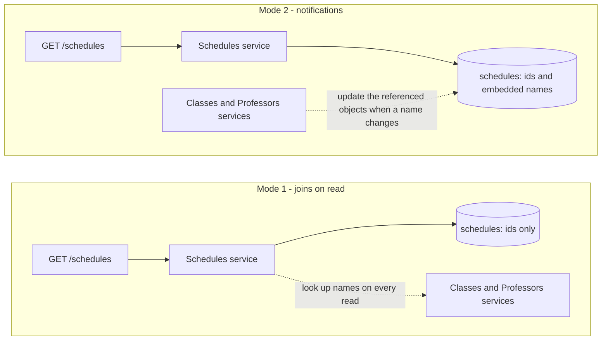

|                        | Mode 1: joins on read (classical)                      | Mode 2: notifications (read-optimized)                                                |
| ---------------------- | ------------------------------------------------------ | ------------------------------------------------------------------------------------- |
| Stored in the document | only the ids of the referenced records                 | the ids **plus a few fields** of the referenced record (for example `name`, `status`) |
| Work done by a `GET`   | extra lookups to fill in the references, on every read | none: one read of one collection                                                      |
| Work done by a change  | none: only the changed record is written               | the owner raises a notification and the subscribers update their referenced objects   |
| Freshness              | always current                                         | current once the notification has been processed (see the caveats)                    |
| Duplicated data        | none                                                   | yes, limited to the declared projection                                               |
| Filter and sort on it  | not in the database                                    | yes, it is a stored field                                                             |
| Best when              | the data changes often, or reads are rare              | the data changes rarely and the system is optimized for `GET`                         |

**Rule of thumb:** mode 2 pays on the write so that every read is cheap. A class name is read thousands of times for each rename, so embed it. Something that changes about as often as it is read should be joined.

> **Illustrative numbers.** A school shows its schedule list 2,000 times a day, each list needs a class and a professor name, and one class is renamed per day. Mode 1 makes about 4,000 extra lookups a day. Mode 2 makes a few `updateMany` writes when the class is renamed, and no extra lookups.

### Mode 1: joins on read

Documents hold only ids. The read path fills in the references in bulk: **one lookup per reference field for the whole page of results**, not one per row.

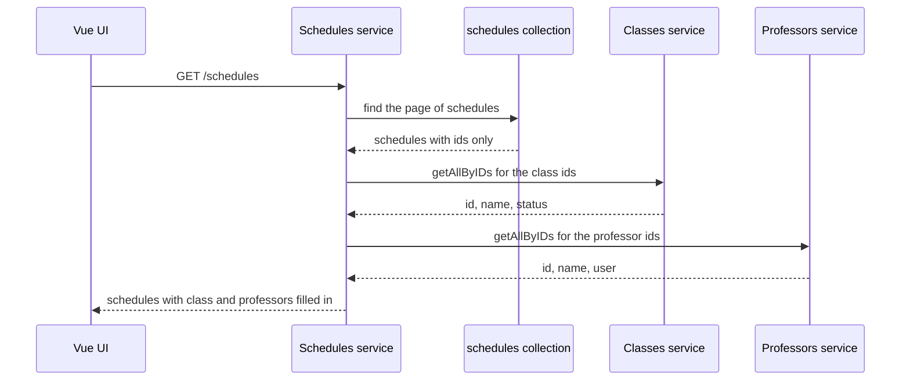

```jsonc
// stored in the schedules collection: ids only
{ "id": "sch-1", "name": "Mathematics 1A - Monday", "class": { "id": "class-1" }, "professors": [{ "id": "prof-1" }] }

// returned by GET, after the lookups
{
  "id": "sch-1",
  "name": "Mathematics 1A - Monday",
  "class": { "id": "class-1", "name": "Mathematics 1A", "status": "active" },
  "professors": [{ "id": "prof-1", "name": "Ada Lovelace" }],
}
```

**What you get:** renaming the class touches only the `classes` collection, and the next `GET /schedules` already shows the new name. Nothing is duplicated and nothing can become stale.

**What it costs:**

- Every `GET /schedules` also queries the classes, professors, groups, students, and locations services, so its speed depends on all of them.
- The database cannot filter or sort on a field it does not store. Today `GET /students` can be sorted by `user.name` and filtered by `classes.name` because those referenced objects are stored in the student document. In mode 1 such a query would have to be resolved in the service, or dropped.

> **Current state.** The shipped services are wired for mode 2. Mode 1 uses the same building blocks (the `references` configuration and `ReferencesUtils.populateReferences`), but the call has to move from the write path to the read path of a service. There is no global switch yet. For a service that should use mode 1:
>
> 1. Do not call `ReferencesUtils.populateReferences({ ...config, fillReferences: true }, ...)` in `post`, `put`, and `patch`, so only ids are stored.
> 2. Call it on the results of `getAll` and `getOne` (and on the values returned by the write calls, if the response must be expanded):
>
>    ```js
>    const r = await Public.getAll(filter, _ctx);
>    await ReferencesUtils.populateReferences({ ...config, fillReferences: true }, r.value, _ctx);
>    ```
>
> 3. Do not register the service as a subscriber in `src/services/config.services.js`, because there are no referenced objects to maintain.

### Mode 2: notifications

The referenced data is **embedded in the referring document when it is written**, and kept current by notifications. A `GET` does no joins at all.

This is what happens when a class is renamed:

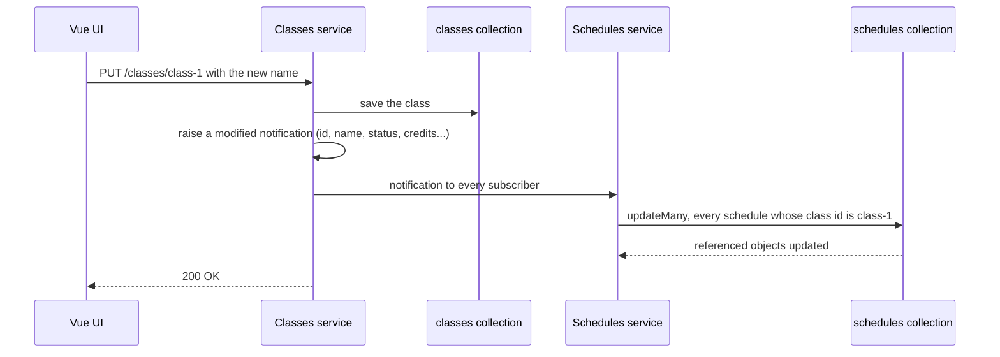

And this is a read afterwards: one collection, no lookups.

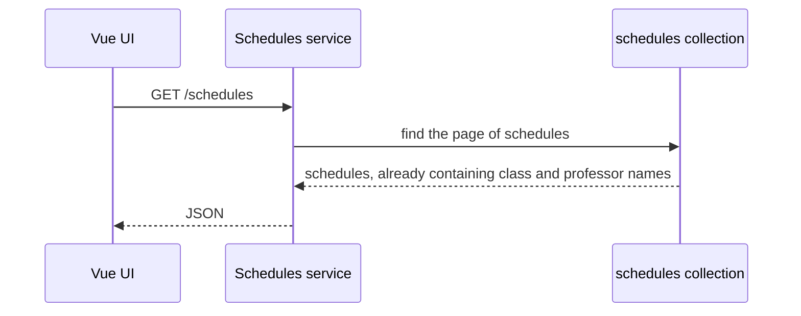

What is stored is the **projection** declared for the reference. Here the schedule keeps `id`, `name`, `type`, `status`, `description`, `credits`, and `required` of its class:

```jsonc
// stored in the schedules collection: ids plus the referenced fields. GET returns it as it is.
{
  "id": "sch-1",
  "name": "Mathematics 1A - Monday",
  "class": { "id": "class-1", "name": "Mathematics 1A", "status": "active", "credits": 3, "required": "required" },
  "professors": [
    {
      "id": "prof-1",
      "name": "Ada Lovelace",
      "status": "active",
      "user": { "id": "user-1", "email": "ada@example.test" }
    }
  ]
}
```

#### How it is configured

There are three places, and each answers one question.

**1. What is embedded?** The `references` in the `getConfig` of the service that stores the referenced object. `fieldName` is the field that holds the reference (`class`, `professors[]`, `schedules[].location`), and `projection` selects the embedded fields.

```js
// src/services/schedules/schedules.service.js
references: [
  { fieldName: 'class', service: ClassesRest, projection: { id: 1, name: 1, type: 1, status: 1, description: 1, credits: 1, required: 1, modifiedCount: 1 } },
  { fieldName: 'professors[]', service: ProfessorsRest, projection: { id: 1, name: 1, type: 1, status: 1, user: 1, modifiedCount: 1 } },
],
```

**2. Who is told?** The owner raises a notification after each successful `post`, `put`, `patch`, and `delete`. `config.services.js` subscribes the dependent services, and the subscription projection selects what is sent.

```js
// src/services/config.services.js
for (const rest of [StudentsRest, ProfessorsRest, SchedulesRest]) {
  const projection = { ...notifyProjection, description: 1, credits: 1, required: 1 };
  await ClassesRest.subscribe({ callback: rest.notification, projection });
}
```

**3. What happens on receipt?** The subscriber's `notification` handler calls the handler of that source (`onClassesNotification`, `onUsersNotification`, ...), which says what it does: for example the schedules update a modified class where they reference it and remove a deleted one; the students take a group that lists them and leave a group that does not list them anymore. A referenced object is updated only when it is older than the change: the same record (the same `createdTimestamp`) with a smaller or missing `modifiedCount`, or a record created again with the same id (another `createdTimestamp`, for example an account created again by an invitation); one `updateMany` for each changed record and reference (`DbOpsUtils.updateManyReferences`, and the matching add and delete helpers). The service then notifies the records whose referenced objects changed, so the objects that reference them follow: a user changes its students, a student changes its groups, a group changes its schedules. A change that comes back to a service through a cycle finds its referenced objects up to date, so nothing is updated and the chain stops.

#### Who notifies whom

An arrow means: "the source raises notifications, and the target uses them to update its referenced objects". The exact lists are in `src/services/config.services.js`.

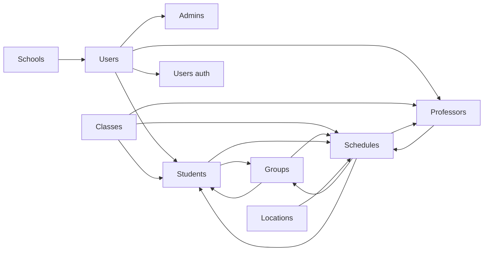

Examples from this project:

- A class rename updates the class where it is referenced: in schedules, students, and professors.
- A change of a student (for example its classes, or its status when it leaves the school) updates it where it is referenced: in groups and schedules.
- A rename of a user updates its students, professors and admins, then the groups and the schedules that keep those students.
- A school rename or status change updates the school memberships stored in every user. That is why the login response and the tenant selector need no school lookup.

#### Caveats

- **Write amplification:** one change fans out to every collection that references it, and one change can touch several levels of referenced objects (user, student, group, schedule). Keep the projections small. The notification projection of the owner limits what is sent.
- **Consistency:** notifications are delivered synchronously, in the same process, right after the write. A failing subscriber does not stop the request and is not rolled back: its handler logs the failed object and still does the next ones, and the failed update leaves a stale referenced object until the next change (it is not retried). The queue-based asynchronous delivery (`broadcast` and `consume` in `base-service.notifications.utils.js`) is a placeholder and is not implemented yet.
- **Embed only what lists need:** fields that are shown in `GET` and rarely change (names, statuses, addresses). Fields that change often should be joined (mode 1) or fetched with the detail request.

### Choosing a mode

The choice is made **per reference**, not per project. A service can embed the class (small, rarely changes, shown in every row) and join the students (large, changes often).

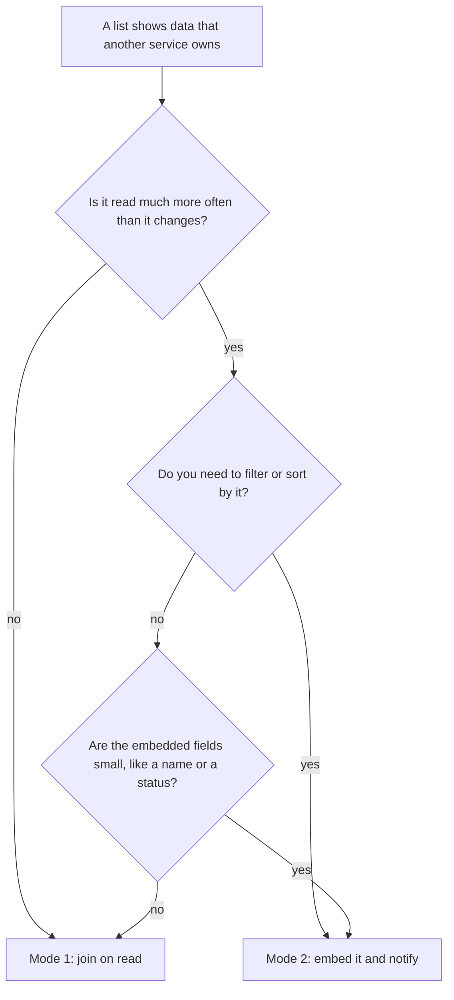

## Sizing guide

How the design behaves under load, and what to do about it. Numbers are of three kinds: **measured** (a micro-benchmark on one laptop core against a stubbed database, not a load test), **derived** (counted from the code), and **assumed** (stated). Database-side figures are assumptions.

### What a request costs

| Operation                              | Cost                                                                                                                                    |
| -------------------------------------- | --------------------------------------------------------------------------------------------------------------------------------------- |
| Authenticated request, validation only | about 0.2 ms CPU (measured); 2 database reads (the session, the user), and at most one write per session every 5 minutes (its last use) |
| List request (`GET /students`)         | about 1.0 to 1.2 ms CPU (measured); 4 database reads (session, user, `find`, `count`)                                                   |
| `GET /users-auth/me`                   | about 0.5 ms CPU (measured); 2 reads                                                                                                    |
| `PUT /classes/:id` (with references)   | about 1.0 to 1.1 ms CPU (measured); 2 reads and 5 writes                                                                                |
| Login                                  | about 59 ms CPU for the two `scrypt` hashes (measured), 3 reads, 2 writes (and a delete when the user has too many sessions)            |

The API processes hold no session state (the sessions are records in the database), so they scale by adding processes. Requests are cheap; **login is the expensive operation**, because password hashing is deliberately slow.

### Rough capacity

Assumptions: about 1.5 ms of CPU for a cheap request (the measured cost plus driver work), 2 requests per active user per minute, one single-core process per pod at 70% utilisation, a login of about 59 ms of CPU, and a database node that serves roughly 30,000 to 50,000 simple indexed reads per second. Measure with your own data before relying on any of it.

| Load                                                         | Needs                                                                                                           |
| ------------------------------------------------------------ | --------------------------------------------------------------------------------------------------------------- |
| 1M logins in 1 hour                                          | about 18 cores of hashing, about 26 single-core pods                                                            |
| 1M logins in 10 minutes                                      | about 107 cores, about 150 pods                                                                                 |
| 1M active users at 2 requests per minute (33,000 requests/s) | about 51 cores, about 75 pods, about 120,000 database reads/s and 3,300 writes/s (the last use of the sessions) |

The session and user lookups on every request are about half of all reads, and list counts touch the whole school's collection.

### What to tune first

In order of effect, none of which needs a different architecture:

1. Limits that fit a school: key the login and API limits on the account and tenant (a school is behind one network address) and keep them in a shared store.
2. Fail with `503` and `Retry-After` when the database cannot be reached, so clients back off instead of logging in again.
3. Hash asynchronously with a bound, and do not hash a random password at invite.
4. Short access tokens with a refresh token, so password logins are rare.
5. Cache the user and memberships lookup for a few seconds, invalidated on role or status changes.
6. Cheaper list counts and bounded page sizes (the connections, the wait for one and the time of a database call are bounded already, `SMALL_API_DATABASE_LIMITS`).

### Queued work

Making every API call a job with a job id and polling does not help login or reads, adds about three writes and several polls per call, and makes the jobs collection the hot spot. The better fit is a **hybrid**: login, token validation, reads, and small writes stay synchronous; **notification fan-out, emails, audit events, bulk invites, school setup, and reports** go through a durable outbox, using the `broadcast` and `consume` seams that already exist. The job id then appears only for long operations, with a short wait first, then polling with backoff and jitter.

## Local development

Use Node.js (24), npm, Docker Compose, and MongoDB. Install the backend and the frontend separately, from their committed lockfiles (`npm ci` installs exactly the versions of `package-lock.json`):

```sh
cd src && npm ci
cd ../ui && npm ci
```

The dependency versions are pinned. After changing one, commit the updated `package-lock.json`. The CI checks every change and every week that the production dependencies have no advisory of high or critical severity (`.github/workflows/dependencies.yml`, `npm audit --omit=dev --audit-level=high`).

### Backend configuration

The backend reads its settings from the **process environment**. [src/.env.example](src/.env.example) is only a template: `src/index.js` does not load a `.env` file, so set the values in your shell, container, or process manager.

| Setting                        | What to set                                                                                                                                                                                                                                                                                           |
| ------------------------------ | ----------------------------------------------------------------------------------------------------------------------------------------------------------------------------------------------------------------------------------------------------------------------------------------------------- |
| `SMALL_API_AUTH_PROVIDER_TYPE` | `local` for username and password authentication                                                                                                                                                                                                                                                      |
| Database                       | `SMALL_API_DATABASE_URL` and `SMALL_API_DATABASE_DB`                                                                                                                                                                                                                                                  |
| `SMALL_API_DATABASE_LIMITS`    | optional. `connections=16;connwaitmax=30s;timeout=30s` (the defaults, each optional): the connections of each process to each member of the replica set, the wait for a free one, the time of a database call (then `503`). Keep processes x connections under what a member accepts                  |
| Secrets                        | `SMALL_API_SALT`, `SMALL_API_AUTHPASS`, `SMALL_API_PREVAUTHPASS` (the previous one, for key rotation) and `SMALL_API_S2SPASS`, generated as the template shows. In production the service does not start with the example values, weak values, or a service-to-service secret equal to an auth secret |
| SMTP                           | the mail server. Invitations and password setup are sent by email, so it is required                                                                                                                                                                                                                  |
| Server                         | port, public URL (`SMALL_API_URL`: also an allowed CORS origin, the `Origin` of the calls between services), and the CORS origins                                                                                                                                                                     |
| `SMALL_API_TRUST_PROXY`        | the proxies in front of the API: their number (`1`) or addresses (`loopback, 10.0.0.0/8`). The client address (rate limits, events) is then taken from them. Not set: no proxy is trusted                                                                                                             |
| `SMALL_UI_URL`                 | the address of the UI. The links of the emails (set a password, open the application) point to it                                                                                                                                                                                                     |
| `SMALL_API_COOKIE_SAMESITE`    | optional. `lax` (default) when the UI and the API are on the same site, `none` when they are on different sites. Outside debug mode the cookie is always `Secure`                                                                                                                                     |
| `SMALL_API_RATE_LIMIT_*`       | optional limits per 15 minutes: `MAX` (all requests of an address, 1000), `LOGIN_MAX` (failed logins of an account from an address, 5), `LOGIN_ACCOUNT_MAX` (failed logins of an account, 20), `RESET_MAX` (reset emails of an account, 3). They are kept in each process                             |
| `SMALL_API_INTERNAL_ROUTES`    | `true` only when the services run in separate processes and call each other over HTTP. Otherwise the internal routes (`/api/internal_v1`) answer `404`; block that prefix at the proxy in any case                                                                                                    |
| `SMALL_API_PORTAL_SCHOOL_ID`   | a UUID. The Portal School is created with this id at startup if it is missing                                                                                                                                                                                                                         |
| `SMALL_API_PORTAL_ADMIN_EMAIL` | optional. The email of the first portal admin. If the Portal School has no active portal admin, it is invited at startup and receives the password setup email. See [The Portal School](#the-portal-school)                                                                                           |
| `SMALL_API_PENDING_EXPIRES_IN` | optional. The seconds a pending user (an invitation not used) or a pending school (a signup without a login) is kept before it is removed, 259200 (72 hours) by default. See [Statuses](#statuses-change-tracking-and-deletion)                                                                       |

**Emails are stored in lower case.** One mailbox is one account, so every email is normalized (trimmed, lower case) when it is validated and when it is looked up.

### Run it

```sh
cd src && npm run up     # start the local MongoDB container
cd src && npm start      # start the API (after setting the environment)
cd ui && npm run serve   # start the Vue development server (configure ui/.env.example first)
cd ui && npm run build   # production build of the frontend
```

### Tests

```sh
cd src && npm test       # unit tests (Mocha and Sinon), no database needed
cd src && npm run testdb # also the functional tests, with the MongoDB of SMALL_API_DATABASE_URL
```

The tests set their own settings: the `SMALL_API_*` and `SMALL_UI_*` values exported in the shell are not used, and the unit tests never connect to a database or a mail server. `npm run testdb` uses the database `Small-Test` of `SMALL_API_DATABASE_URL` and empties it at the start; its functional tests run the flows of the API on it (login, logout, signup, invite, the remove of a role and the role given again, the delete of an account and its invitation again, the school settings, the expiry of the invitations).

The fixture credentials in `src/test/test-constants.js` are for tests only. They are not accounts of the application.

## Authentication

The local provider checks a username and password against the local auth collection. **The user must already exist**: users are created by an invitation (or, for the very first portal admin, by the startup setting above), never by a public signup.

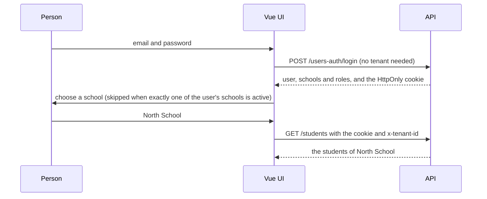

Login does not need a tenant. It returns the school memberships with their statuses and sets the HttpOnly `SmallApp-token` cookie. **The token itself is never returned in the JSON body.**

### UI login

The login component uses the shared API wrapper and processes the response before it opens the tenant selector:

```js
import Api from '../api/api.js';
import { processLoginResponse } from '../auth.js';

const response = await Api.login({ username, password });
const result = await processLoginResponse(response);
```

`Api.login` sends credentials. If exactly one of the user's schools is active, the UI selects it. Otherwise the user chooses. After a page refresh the chosen school stays chosen: it is checked again against the schools of the user (an active membership with roles) and cleared when it is not valid anymore. From then on the API wrapper adds the school id as `x-tenant-id`.

### Login with curl

Set the API address, then save the cookie that login returns:

```sh
API='http://localhost:8080/api/v1'
ORIGIN='http://localhost:8081'

curl --include --cookie-jar cookies.txt \
  --header "Origin: $ORIGIN" \
  --header 'Content-Type: application/json' \
  --data '{"username":"user@example.test","password":"your-password"}' \
  "$API/users-auth/login"
```

The response contains `userID`, `username`, `status`, `name`, and `schools`. Pick the id of an active school from `schools` and send it on every tenant request:

```sh
TENANT_ID='school-id-from-login'

curl --cookie cookies.txt \
  --header "Origin: $ORIGIN" \
  --header "x-tenant-id: $TENANT_ID" \
  "$API/students?limit=20&skip=0"
```

To restore the session call `GET /users-auth/me` with the cookie. To log out call `POST /users-auth/logout` with the cookie: it clears the cookie and ends this session (the sessions on other devices stay open).

**Sessions.** Each login starts a session: a record in its own collection (`users-auth-sessions`) with the user, the purpose and the expiry. The cookie carries a random secret, and the record keeps only its SHA-256 hash, so a copy of the collection opens nothing. Every request checks the record, so a session ends as soon as its record is removed:

- logout ends that session;
- a password change, a password reset, an email change or a removed account ends all the sessions of the user (a password change keeps the current session with a new cookie);
- a session without requests for 30 minutes ends (a computer left open); its last use is saved at most every 5 minutes, so most requests do not write;
- a user has at most 10 open sessions: a new login ends the oldest ones;
- the cookie and the record expire with the session (12 hours at most), and the database removes the expired records.

The limits are `SessionLimits` and `TokenExpiresIn` in `src/services/users-auth/users-auth.constants.js`.

The emailed links (reset password, invitation) have records too: a link is used once, a newer link replaces the older ones, and a password change ends them. A session token is only a session: a link can not be used as a cookie, and a cookie can not set a password.

## API conventions

| Topic          | Rule                                                                                                                                                                                                                                                                                 |
| -------------- | ------------------------------------------------------------------------------------------------------------------------------------------------------------------------------------------------------------------------------------------------------------------------------------ |
| Prefixes       | Public routes use `/api/v1`. Internal service routes use `/api/internal_v1` and are not for browsers or third parties                                                                                                                                                                |
| Authentication | The HttpOnly cookie, plus `x-tenant-id` on tenant routes                                                                                                                                                                                                                             |
| Lists          | `GET` on a collection returns `{ data, meta }`, where `meta` has `count`, `limit`, `skip`, and `sort`. A partial list returns `206`. `limit` is from 1, or `-1` for all (at most 10000); `skip` is from 0                                                                            |
| Queries        | The `api-query-params` syntax: `limit`, `skip`, `sort`, `projection`, and the filters a service allows, with the allowed operators only. A search is a regular expression: the UI escapes the typed text and matches the letters with or without diacritics                          |
| Languages      | A translated field (`_lang_<language>.status`, `_lang_<language>.user.status`) is searched in the language of the request (`x-lang`, the language of the UI); a filter of another language is refused                                                                                |
| Input          | The owning service validates the JSON body (none is `{}`, another content type is `415`). Unknown fields are rejected and an empty change is refused; related ids are looked up and the references are filled in                                                                     |
| `PATCH`        | Uses `set`, `add`, `remove`, or `unset`, depending on the service. The examples below show relation updates                                                                                                                                                                          |
| Errors         | `{ message }`, a generic text for the status. A refused request (`400`, `409` a value already used, `415`) also has `detail`, the reason. `401`, `403`, `404` and `5xx` never give one (an account is not revealed, a server error hides its cause). Debug mode adds `error`         |

Example list response:

```json
{
  "data": [{ "id": "class-1", "name": "Mathematics 1A", "status": "active" }],
  "meta": { "count": 1, "limit": 20, "skip": 0 }
}
```

Example of a refused request (outside debug mode):

```json
{ "message": "Request is not valid", "detail": "You cannot remove yourself as admin" }
```

## Walkthrough: from a new school to a schedule

This is the usual order of things, from the point of view of the people involved. The sections below show each call in detail.

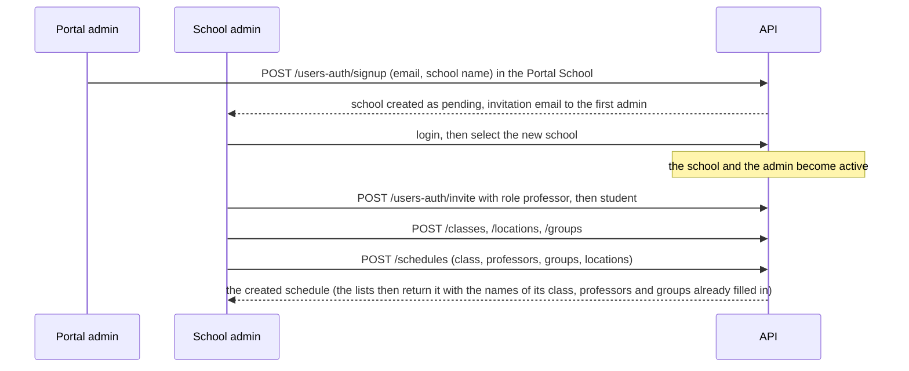

1. **A portal admin creates the school** (the Portal School is the selected tenant). The first admin is invited by email.
2. **The school admin logs in**, sets a password from the email, and selects the school. This activates the admin and the school.
3. **The admin invites people** by role. Each invitation creates (or updates) the user and adds the school membership.
4. **The admin creates the school data:** classes, locations, and groups.
5. **The admin creates schedules** that point to those records. The response and later lists contain the names of the referenced records, as explained in [Data modes](#data-modes-joins-or-notifications).

## Services and examples

All UI examples use the shared `Api` object from `ui/src/api/api.js`. Its Axios instance sends the cookie and selected tenant header automatically. Curl examples use the `API`, `ORIGIN`, `TENANT_ID`, and `cookies.txt` values from [Login with curl](#login-with-curl).

### Schools

There are two kinds of schools. They are listed separately in the API and in the UI, and the [Portal School](#the-portal-school) section explains why.

| Kind              | How it is listed                                                  | How users are added                                                                                                                                       |
| ----------------- | ----------------------------------------------------------------- | --------------------------------------------------------------------------------------------------------------------------------------------------------- |
| Managed schools   | `GET /schools` (portal admins only, the Portal School is omitted) | A school is created with `POST /users-auth/signup`, which also invites its first admin. That admin then invites the others with `POST /users-auth/invite` |
| The Portal School | Not listed. Its admins are listed with `GET /users/portal-admins` | `POST /users-auth/invite` with the role `portal-admin`, while the Portal School is the selected tenant                                                    |

**There is no school-specific "invite admin" route.** Every invitation uses the same `POST /users-auth/invite` flow, and the school comes from the selected tenant. A new user receives the signup and password setup email. An existing user receives the invite email. An invitation (and a signup) has a language (`language`: `en` or `ro`); without it, the language of the person who invites (the language of the UI, sent in `x-lang`). The email is in that language, and a new user gets it as the language of its profile.

A new school starts as `pending` and becomes `active` when its first admin logs in. A school can be disabled, and a disabled school is no longer offered in the tenant selector. The Portal School cannot be deleted or disabled, and portal admins cannot delete schools.

```js
// managed schools
await Api.getSchools('limit=20&skip=0');
await Api.signup({ email: 'admin@example.test', school: { name: 'North School', description: 'North campus' } });
await Api.updateSchool('school-id', { name: 'North School', status: 'active' });

// the portal admins (the selected tenant is the Portal School)
await Api.invitePortalAdmin('another-portal-admin@example.test');
await Api.getPortalAdmins('limit=20&skip=0');
await Api.removePortalAdmin('user-id');
```

```sh
# managed schools
curl --cookie cookies.txt -H "Origin: $ORIGIN" -H "x-tenant-id: $TENANT_ID" "$API/schools?limit=20&skip=0"

curl --cookie cookies.txt -H "x-tenant-id: $TENANT_ID" \
  -H "Origin: $ORIGIN" \
  -H 'Content-Type: application/json' \
  --data '{"email":"admin@example.test","school":{"name":"North School","description":"North campus"}}' \
  "$API/users-auth/signup"

# the portal admins ($TENANT_ID is the Portal School)

curl --cookie cookies.txt -H "x-tenant-id: $TENANT_ID" \
  -H "Origin: $ORIGIN" \
  -H 'Content-Type: application/json' \
  --data '{"email":"another-portal-admin@example.test","school":{"role":"portal-admin"}}' \
  "$API/users-auth/invite"

curl --cookie cookies.txt -H "Origin: $ORIGIN" -H "x-tenant-id: $TENANT_ID" "$API/users/portal-admins?limit=20&skip=0"

curl --cookie cookies.txt -H "x-tenant-id: $TENANT_ID" \
  -H "Origin: $ORIGIN" \
  -H 'Content-Type: application/json' -X PATCH \
  --data '{"remove":{"roles":["portal-admin"]}}' \
  "$API/users-auth/school/user/user-id"
```

School status can be edited so disabled schools are unavailable in tenant selection. The Portal School cannot be deleted or disabled. School deletion is not granted to portal admins.

The admins of a school read and change its settings (the Settings page): `removedMembers` is `keep` (the removed people stay, marked `removed` or `deleted`) or `delete` (their records are deleted, with their places in groups and schedules); `classmates` is `show` (the default: a student sees the other students of its groups and schedules) or `hide` (only itself). A `PUT` sends all the settings.

```js
await Api.getSchoolSettings('school-id');
await Api.updateSchoolSettings('school-id', { removedMembers: 'keep' });
```

```sh
curl --cookie cookies.txt -H "x-tenant-id: $TENANT_ID" \
  -H "Origin: $ORIGIN" \
  -H 'Content-Type: application/json' -X PUT \
  --data '{"removedMembers":"keep"}' \
  "$API/schools/$TENANT_ID/settings"
```

### Admins, Students, and Professors

These records are linked to users. The UI's add action uses the invite endpoint; it does not create a person record that has no user. Invite bodies require the role and selected school context. The delete of a person removes its role in the school; the record follows the school setting (kept as `removed`, or deleted). The delete of a record that is already kept (`removed` or `deleted`) removes it for good. The lists show the status of the user of the record (`user.status`), so a removed person is visible as `removed` or `deleted`.

| Record    | UI call                                                       | Collection curl                         | Invite role |
| --------- | ------------------------------------------------------------- | --------------------------------------- | ----------- |
| Admin     | `Api.getAdmins(query)` / `Api.createAdmin({ email })`         | `GET "$API/admins?limit=20&skip=0"`     | `admin`     |
| Student   | `Api.getStudents(query)` / `Api.createStudent({ email })`     | `GET "$API/students?limit=20&skip=0"`   | `student`   |
| Professor | `Api.getProfessors(query)` / `Api.createProfessor({ email })` | `GET "$API/professors?limit=20&skip=0"` | `professor` |

Example student invite and collection request:

```sh
curl --cookie cookies.txt -H "x-tenant-id: $TENANT_ID" \
  -H "Origin: $ORIGIN" \
  -H 'Content-Type: application/json' \
  --data '{"email":"student@example.test","school":{"role":"student"}}' \
  "$API/users-auth/invite"

curl --cookie cookies.txt -H "Origin: $ORIGIN" -H "x-tenant-id: $TENANT_ID" "$API/students?limit=20&skip=0"
```

Use the same curl request with `"role":"professor"` or `"role":"admin"` for the other invite types. The table shows each collection request. The entity routers also expose `GET /:id`, `POST /`, `PUT /:id`, `PATCH /:id`, and `DELETE /:id` where allowed by the role matrix; the UI add action intentionally uses invites because these records are linked to user accounts.

Students and professors can be attached to classes through patch operations:

```js
await Api.updateStudentClasses('student-id', ['class-id-to-add'], ['class-id-to-remove']);
await Api.updateProfessorClasses('professor-id', ['class-id-to-add'], []);
```

```sh
curl --cookie cookies.txt -H "x-tenant-id: $TENANT_ID" \
  -H "Origin: $ORIGIN" \
  -H 'Content-Type: application/json' -X PATCH \
  --data '{"add":{"classes":[{"id":"class-id"}]},"remove":{"classes":[]}}' \
  "$API/students/student-id"
```

### Classes

Classes are school-scoped. `required` accepts `required` or `optional`; credits default to zero and status defaults to pending.

```js
await Api.getClasses('limit=20&skip=0');
await Api.createClass({
  name: 'Mathematics 1A',
  description: 'Introductory mathematics',
  credits: 3,
  required: 'required',
});
```

```sh
curl --cookie cookies.txt -H "x-tenant-id: $TENANT_ID" \
  -H "Origin: $ORIGIN" \
  -H 'Content-Type: application/json' \
  --data '{"name":"Mathematics 1A","description":"Introductory mathematics","credits":3,"required":"required"}' \
  "$API/classes"
```

### Locations

Locations require a name and address. Schedules reference a location by ID.

```js
await Api.getLocations('limit=20&skip=0');
await Api.createLocation({ name: 'Room 12', address: 'North building, floor 2' });
```

```sh
curl --cookie cookies.txt -H "x-tenant-id: $TENANT_ID" \
  -H "Origin: $ORIGIN" \
  -H 'Content-Type: application/json' \
  --data '{"name":"Room 12","address":"North building, floor 2"}' \
  "$API/locations"
```

### Groups

Groups contain student references. Membership changes use `add.students` and `remove.students`.

```js
await Api.getGroups('limit=20&skip=0');
await Api.createGroup({ name: 'Group A', description: 'Morning group', students: [{ id: 'student-id' }] });
await Api.updateGroupStudents('group-id', ['student-id-to-add'], []);
```

```sh
curl --cookie cookies.txt -H "x-tenant-id: $TENANT_ID" \
  -H "Origin: $ORIGIN" \
  -H 'Content-Type: application/json' \
  --data '{"name":"Group A","description":"Morning group","students":[{"id":"student-id"}]}' \
  "$API/groups"
```

### Schedules

A schedule belongs to one class and can refer to professors, groups, and students. Each schedule time includes an ISO timestamp, frequency, location ID, and optional status. Supported frequencies are `once`, `weekly`, `biWeekly`, and `monthly`.

```js
await Api.getSchedules('limit=20&skip=0');
await Api.createSchedule({
  name: 'Mathematics 1A - Monday',
  class: 'class-id',
  schedules: [
    { timestamp: '2026-11-16T09:00:00.000Z', frequency: 'weekly', location: 'location-id', status: 'active' },
  ],
  professors: [{ id: 'professor-id' }],
  groups: [{ id: 'group-id' }],
  students: [],
});
```

```sh
curl --cookie cookies.txt -H "x-tenant-id: $TENANT_ID" \
  -H "Origin: $ORIGIN" \
  -H 'Content-Type: application/json' \
  --data '{"name":"Mathematics 1A - Monday","class":"class-id","schedules":[{"timestamp":"2026-11-16T09:00:00.000Z","frequency":"weekly","location":"location-id","status":"active"}],"professors":[{"id":"professor-id"}],"groups":[{"id":"group-id"}],"students":[]}' \
  "$API/schedules"
```

Relationship changes use `Api.updateScheduleInnerSchedules`, `Api.updateScheduleGroups`, `Api.updateScheduleProfessors`, and `Api.updateScheduleStudents`; each helper issues a `PATCH /schedules/:id` with `add` and `remove` arrays.

### Users

Users are global profile records referenced by school-backed person records. Access to other users is role-limited; a user can also access their own profile.

```js
await Api.getUser('user-id');
await Api.updateUser('user-id', { name: 'Updated Name' });
```

```sh
curl --cookie cookies.txt -H "Origin: $ORIGIN" -H "x-tenant-id: $TENANT_ID" "$API/users/user-id"
```

### Users Auth

In addition to login, logout, and `GET /users-auth/me`, the service provides `POST /users-auth/invite`, `POST /users-auth/reset-password`, `PUT /users-auth/password`, `PUT /users-auth/id`, `PATCH /users-auth/school/user/:uid`, and `DELETE /users-auth` (the current user deletes its account; see [Deleting a user keeps the traces](#deleting-a-user-keeps-the-traces)). Signup is restricted to portal admins; invite is available to school admins (for their selected school) and to portal admins (for the Portal School). Internal auth routes are not public APIs.

```js
await Api.invite({ email: 'student@example.test', school: { role: 'student' } });
await Api.updateUserPassword({ oldPassword, newPassword });
```

```sh
curl --cookie cookies.txt -H "x-tenant-id: $TENANT_ID" \
  -H "Origin: $ORIGIN" \
  -H 'Content-Type: application/json' \
  --data '{"username":"user@example.test"}' \
  "$API/users-auth/reset-password"
```

The local auth provider sends a signup/password setup message to a newly created user and an invitation message to an existing user. SMTP settings and the email templates in `src/translations/` are required for delivery.

The link of a reset email opens the UI page `/reset-password`, and the link of an invitation the page `/setup-account` (`SMALL_UI_URL`). The token is in the fragment of the link (after `#`), which the browser never sends to a server; the page removes it from the address bar and sends it in a header: `x-reset-token` to `GET /users-auth/reset-token/validate` and `PUT /users-auth/reset-token/password` (a reset link only), `x-setup-token` to `GET /users-auth/setup-token/validate` and `PUT /users-auth/setup-token/account` (an invitation link only). A link is valid for 1 hour (reset) or 72 hours (invitation), and only once: it is made for the current password, so setting the password ends it. The login page has a "Forgot password?" link that asks for a reset email. The link also carries the language of the email (`lang`), and the page opens in it. The link of an invitation sets up the account: the first password and the profile of the user (`PUT /users-auth/setup-token/account` with `{ password, profile: { name, birthday?, phoneNumber?, address?, language? } }`); the link of a reset sets only the password (`{ password }`). A link used on the other page is refused (`401`) and stays valid.

Every user has a language in its profile (`language`, `PUT /users/:id`), returned by the login and by `GET /users-auth/me`: the UI opens in it. The user chooses it in its profile or with the flag in the top bar. Every email exists in each language (`src/translations/<language>.emails.json`).

### Events

Events are raised by services after mutations. School admins can query the events of their school but nobody can create them directly; event creation and notification endpoints are internal.

```js
await Api.getEvents('limit=20&skip=0');
```

```sh
curl --cookie cookies.txt -H "Origin: $ORIGIN" -H "x-tenant-id: $TENANT_ID" "$API/events?limit=20&skip=0"
```

## Code map

| Area                                                          | Location                                                                                  |
| ------------------------------------------------------------- | ----------------------------------------------------------------------------------------- |
| Service startup and configuration                             | `src/index.js`, `src/services/config.services.js`                                         |
| Settings of the application (from the environment)            | `src/services/config.settings.js`                                                         |
| Role-to-route policy                                          | `src/services/config.roles.json`                                                          |
| Domain service modules                                        | `src/services/<service>/`                                                                 |
| Service-to-service REST wrappers                              | `src/services/rest/`                                                                      |
| Shared MongoDB, validation, references, events, notifications | `src/core/utils/` (a library: no reference to this application, it receives its settings) |
| Authentication and invitation flows                           | `src/services/users-auth/`                                                                |
| Web server, middleware, and security headers                  | `src/web-server/`, `src/core/web-server/`                                                 |
| Backend tests                                                 | `src/test/test/` and `src/core/test/`                                                     |
| Vue API client and role-derived permissions                   | `ui/src/api/`, `ui/src/auth.js`                                                           |
| Vue pages and shared tables                                   | `ui/src/components/`                                                                      |
| Vue routing and tenant selection                              | `ui/src/router/`, `ui/src/components/base.tenant.select.vue`                              |
