# small-nodejs-service

A Node.js backend and a Vue application for running **many schools from one portal**.

One person can belong to several schools with a different role in each (for example professor in one school, student in another). Each school only sees its own data. The project is also a reference for a small set of cooperating services that keep their data in MongoDB and talk to each other through REST wrappers and notifications.

## Contents

- [At a glance](#at-a-glance)
- [How a request flows](#how-a-request-flows)
- [Domain model](#domain-model)
- [The Portal School](#the-portal-school)
- [Design principles](#design-principles)
- [Data modes: joins or notifications](#data-modes-joins-or-notifications)
- [Local development](#local-development)
- [Authentication](#authentication)
- [API conventions](#api-conventions)
- [Walkthrough: from a new school to a schedule](#walkthrough-from-a-new-school-to-a-schedule)
- [Services and examples](#services-and-examples)
- [Code map](#code-map)

## At a glance

| Topic          | Summary                                                                                                 |
| -------------- | ------------------------------------------------------------------------------------------------------- |
| Backend        | Express application in `src/`, MongoDB for storage                                                      |
| Frontend       | Vue 3 application in `ui/`                                                                              |
| Multi-tenancy  | Every school is a tenant. The selected school is sent as the `x-tenant-id` header                       |
| Authentication | Username and password, a signed token in an HttpOnly cookie                                             |
| Authorization  | The route-to-role matrix in `src/services/config.roles.json`, checked on every request                  |
| Roles          | `admin`, `professor`, `student` inside a school, and `portal-admin` in the Portal School                |
| Cross-service  | REST wrappers (`src/services/rest/`), events, and notifications                                         |
| Data modes     | Resolve references with **joins on read**, or keep copies up to date with **notifications** (see below) |

## How a request flows

Every request goes through the same checks before it reaches a controller. The backend is authoritative: the UI hides what a user cannot do, but it never decides.

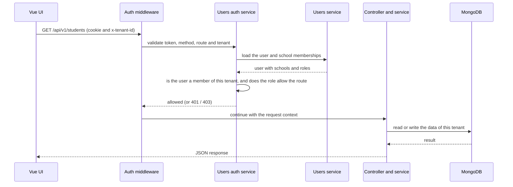

1. **Token:** the browser sends the HttpOnly cookie automatically. The token proves who the user is.
2. **Tenant:** `x-tenant-id` says which school the request is for. The user must be an active member of it.
3. **Route and role:** `config.roles.json` lists which roles may call which route. The role is the one the user has _in that school_.
4. **Context:** the controller receives the resolved user and tenant as `req._ctx`, and services use it to pick the tenant's data.

## Domain model

**Users are global, roles belong to a school membership.** A user is one identity. The list of schools they belong to, and their roles in each, is stored on the user.

| Concept                   | Scope      | What it is                                                                        |
| ------------------------- | ---------- | --------------------------------------------------------------------------------- |
| User                      | global     | A person: name, email, status, and the list of school memberships                 |
| School                    | global     | A tenant. Has a name, description, and a status (`pending`, `active`, `disabled`) |
| Admin, Professor, Student | one school | The school record of a user with that role. It points to the user                 |
| Class                     | one school | A subject, for example "Mathematics 1A"                                           |
| Location                  | one school | A room, with an address                                                           |
| Group                     | one school | A set of students                                                                 |
| Schedule                  | one school | When a class takes place: its professors, groups, students, times, and locations  |

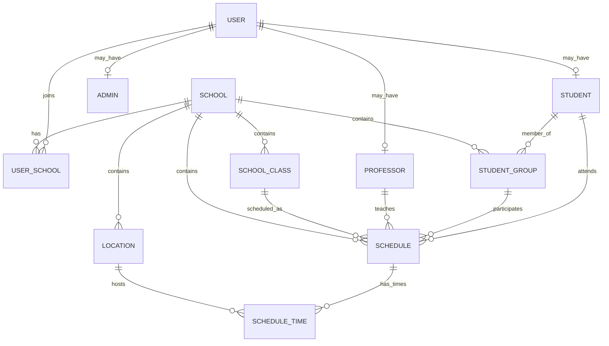

`USER_SCHOOL` and `SCHEDULE_TIME` are not collections: they are the school memberships stored inside the user, and the list of times stored inside the schedule. `SCHOOL_CLASS` and `STUDENT_GROUP` are the class and group records. The diagram does not call them `CLASS` or `GROUP` because `CLASS` is a reserved word in Mermaid's ER diagrams and stops GitHub from rendering the diagram.

### Memberships and roles

This is what the user record looks like. The same person is `admin` in one school and `professor` and `student` in another:

```jsonc
{
  "id": "user-1",
  "email": "ada@example.test",
  "name": "Ada Lovelace",
  "schools": [
    { "id": "school-north", "name": "North School", "status": "active", "roles": ["admin"] },
    { "id": "school-south", "name": "South School", "status": "active", "roles": ["professor", "student"] }
  ]
}
```

After login the UI shows the active schools. The school the user picks becomes `x-tenant-id`, and from then on only the roles of that school count.

| Role           | Where             | What it can do                                                                                                                              |
| -------------- | ----------------- | ------------------------------------------------------------------------------------------------------------------------------------------- |
| `admin`        | a school          | Everything inside the school: manage classes, locations, groups, schedules, admins, professors, and students; invite users; edit the school |
| `professor`    | a school          | Read the school data: classes, locations, schedules, groups, and the lists of professors and students                                       |
| `student`      | a school          | The same read-only access as a professor                                                                                                    |
| `portal-admin` | the Portal School | Runs the portal: creates schools and manages the other portal admins (next section)                                                         |

On top of the role, some routes use the special rule **current user**: any member can read and update **their own** user record (and their own student or professor record), because the id in the path must match the logged-in user. This is how a student edits their own profile without being an admin.

The exact routes of each role are in `src/services/config.roles.json`. A route not listed for a role is refused with `403`.

## The Portal School

The portal needs somewhere to keep its own administrators. Instead of a special case, that place is **a school like the others**: the Portal School.

- Users select it after login, like any other school.
- Inviting a user to it makes that user a **portal admin** (the `portal-admin` role).
- Its id is configured only on the backend (`SMALL_API_PORTAL_SCHOOL_ID`). It is never part of the UI source.
- It always stays active, it cannot be deleted, and it is **not** listed with the managed schools.

Two rules keep it separate from the normal schools, and the backend enforces both:

1. `portal-admin` can only be given on the Portal School.
2. Nothing but `portal-admin` can be given on the Portal School.

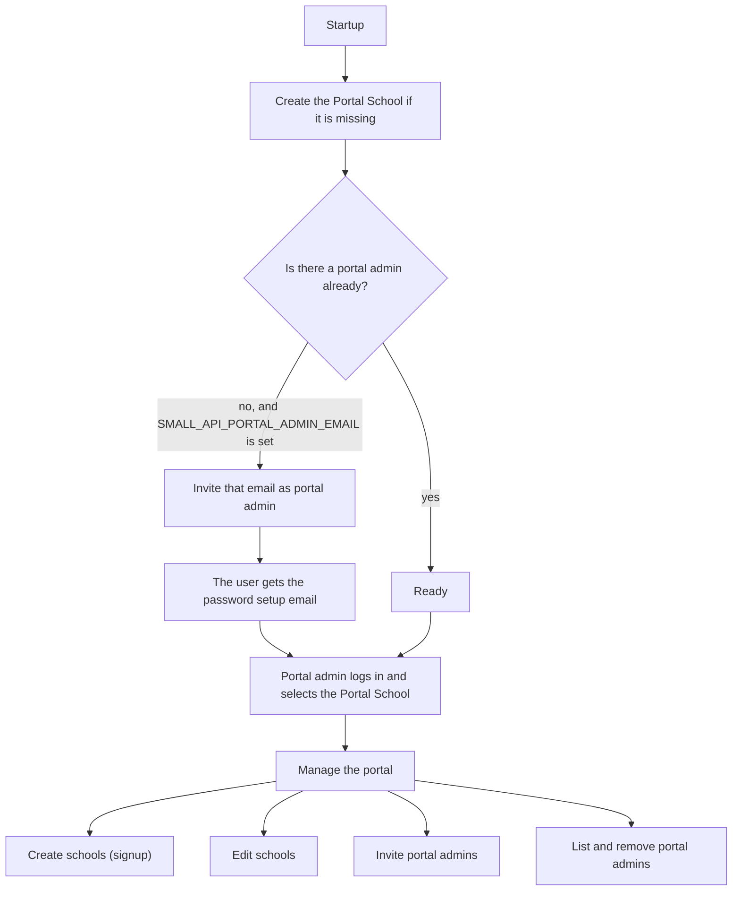

| Action                      | Route                                                  | Who can do it                                               |
| --------------------------- | ------------------------------------------------------ | ----------------------------------------------------------- |
| Create a school             | `POST /users-auth/signup`                              | Portal admin (it invites the first admin of the new school) |
| List managed schools        | `GET /schools`                                         | Portal admin                                                |
| Edit a school               | `PUT` or `PATCH /schools/:id`                          | Portal admin; a school admin for their own school           |
| Invite a portal admin       | `POST /users-auth/invite` with role `portal-admin`     | Portal admin                                                |
| List portal admins          | `GET /users/portal-admins`                             | Portal admin                                                |
| List the admins of a school | `GET /users/school-admins/:schoolId`                   | Portal admin                                                |
| Remove a portal admin       | `PATCH /users-auth/school/user/:uid` (remove the role) | Portal admin (not for their own role)                       |

A portal admin cannot remove their own role, so the Portal School always keeps at least one admin. Removing the role keeps the user account.

**The first portal admin.** Set `SMALL_API_PORTAL_ADMIN_EMAIL` and the first start invites that address through the normal invite flow. The person receives the password setup email, so no password is ever stored in the configuration. It does nothing once a portal admin exists, so it is safe on every restart. There is deliberately no public portal-admin signup.

In the UI, the Schools page has two lists: the **portal admins** and the **managed schools**. The Portal School itself is not shown, because it is always the same: the portal admins list has a **+** to invite a new portal admin and a delete action to remove one. Each managed school can be expanded to show its admins.

## Design principles

| Principle                | What it means                                                                                                                                                                                                                                                                  |
| ------------------------ | ------------------------------------------------------------------------------------------------------------------------------------------------------------------------------------------------------------------------------------------------------------------------------ |
| Tenant context           | Tenant requests need an active membership in `x-tenant-id`. Services check the context before they touch the database                                                                                                                                                          |
| Authorization in the API | `config.roles.json` maps routes to roles. The UI hides and guards for convenience only                                                                                                                                                                                         |
| Layers                   | Router (routes) → controller (HTTP) → service (validation and rules) → database module (collections and indexes). Other services are reached through `src/services/rest/` wrappers                                                                                             |
| Shared helpers           | Joi schemas for input, `RestApiUtils` for list filters, `DbOpsUtils` for MongoDB, reference utilities for related records                                                                                                                                                      |
| Events and notifications | A successful change raises an event and a notification. Subscribers update their copies. Notification routes are internal. See [Data modes](#data-modes-joins-or-notifications)                                                                                                |
| Internal calls           | Services call each other through `RestCommsUtils`: a direct call when they run in the same process, or the internal REST route with service-to-service authentication                                                                                                          |
| Status lifecycle         | `pending`, `active`, `disabled`. The first successful login activates a pending user and school, and a session refresh (`GET /users-auth/me`, used by the school selector) activates the pending schools added after the login. The tenant selector offers only active schools |
| Translations and email   | Response fields are translated by the translation utilities. Strings and email templates are in `src/translations/`                                                                                                                                                            |
| Cookie authentication    | The browser sends the HttpOnly cookie. Never copy the token into a JavaScript `Authorization` header                                                                                                                                                                           |
| Transport and abuse      | CORS allow-list with credentials, security headers, HTTPS redirect in production, and a login limit of three attempts per IP per 15 minutes (outside debug mode)                                                                                                               |
| Password policy          | At least eight characters with uppercase, lowercase, a digit, and a special character. Changing the password or the email needs the current password                                                                                                                           |
| Tests                    | Mocha with Sinon stubs, one suite per service in `src/test/test/`. Database-backed tests are separate (`npm run testdb`)                                                                                                                                                       |

## Data modes: joins or notifications

### The problem

Records point to each other. A schedule points to a class, professors, groups, and students. When the UI lists schedules it shows the _names_ of those things, not just their ids. Where do the names come from?

```jsonc
// what the list must show
{ "name": "Mathematics 1A - Monday", "class": "Mathematics 1A", "professor": "Ada Lovelace" }
```

There are two answers, and the project supports both. They use the same `references` declaration in each service, and you pick one per reference.

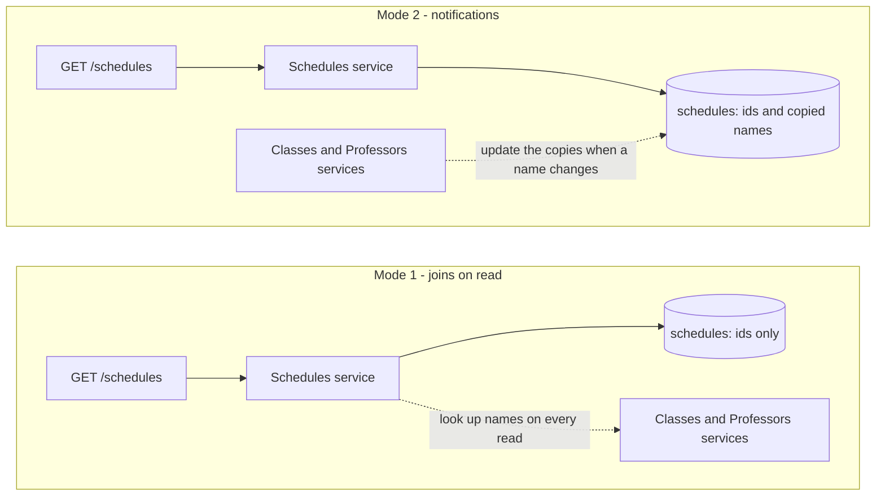

|                        | Mode 1: joins on read (classical)                      | Mode 2: notifications (read-optimized)                                                |
| ---------------------- | ------------------------------------------------------ | ------------------------------------------------------------------------------------- |
| Stored in the document | only the ids of the referenced records                 | the ids **plus a small copy** of the referenced record (for example `name`, `status`) |
| Work done by a `GET`   | extra lookups to fill in the references, on every read | none: one read of one collection                                                      |
| Work done by a change  | none: only the changed record is written               | the owner raises a notification and the subscribers update their copies               |
| Freshness              | always current                                         | current once the notification has been processed (see the caveats)                    |
| Duplicated data        | none                                                   | yes, limited to the declared projection                                               |
| Filter and sort on it  | not in the database                                    | yes, it is a stored field                                                             |
| Best when              | the data changes often, or reads are rare              | the data changes rarely and the system is optimized for `GET`                         |

**Rule of thumb:** mode 2 pays on the write so that every read is cheap. A class name is read thousands of times for each rename, so copy it. Something that changes about as often as it is read should be joined.

> **Illustrative numbers.** A school shows its schedule list 2,000 times a day, each list needs a class and a professor name, and one class is renamed per day. Mode 1 makes about 4,000 extra lookups a day. Mode 2 makes a few `updateMany` writes when the class is renamed, and no extra lookups.

### Mode 1: joins on read

Documents hold only ids. The read path fills in the references in bulk: **one lookup per reference field for the whole page of results**, not one per row.

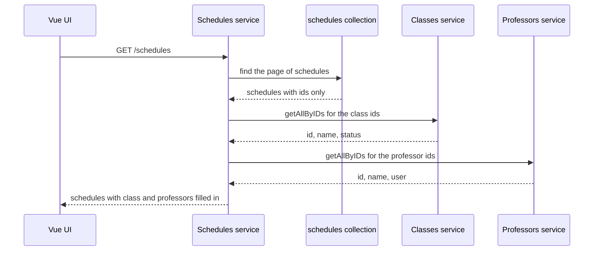

```jsonc
// stored in the schedules collection: ids only
{ "id": "sch-1", "name": "Mathematics 1A - Monday", "class": { "id": "class-1" }, "professors": [{ "id": "prof-1" }] }

// returned by GET, after the lookups
{
  "id": "sch-1",
  "name": "Mathematics 1A - Monday",
  "class": { "id": "class-1", "name": "Mathematics 1A", "status": "active" },
  "professors": [{ "id": "prof-1", "name": "Ada Lovelace" }],
}
```

**What you get:** renaming the class touches only the `classes` collection, and the next `GET /schedules` already shows the new name. Nothing is duplicated and nothing can become stale.

**What it costs:**

- Every `GET /schedules` also queries the classes, professors, groups, students, and locations services, so its speed depends on all of them.
- The database cannot filter or sort on a field it does not store. Today `GET /students` can be sorted by `user.name` and filtered by `classes.name` because those copies are stored in the student document. In mode 1 such a query would have to be resolved in the service, or dropped.

> **Current state.** The shipped services are wired for mode 2. Mode 1 uses the same building blocks (the `references` configuration and `ReferencesUtils.populateReferences`), but the call has to move from the write path to the read path of a service. There is no global switch yet. For a service that should use mode 1:
>
> 1. Do not call `ReferencesUtils.populateReferences({ ...config, fillReferences: true }, ...)` in `post`, `put`, and `patch`, so only ids are stored.
> 2. Call it on the results of `getAll` and `getOne` (and on the values returned by the write calls, if the response must be expanded):
>
>    ```js
>    const r = await Public.getAll(filter, _ctx);
>    await ReferencesUtils.populateReferences({ ...config, fillReferences: true }, r.value, _ctx);
>    ```
>
> 3. Do not register the service as a subscriber in `src/services/config.services.js`, because there are no copies to maintain.

### Mode 2: notifications

The referenced data is **copied into the referring document when it is written**, and kept current by notifications. A `GET` does no joins at all.

This is what happens when a class is renamed:

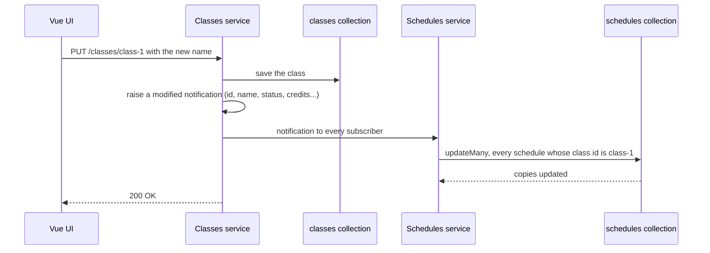

And this is a read afterwards: one collection, no lookups.

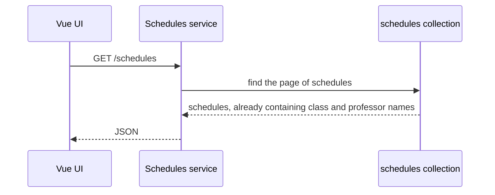

What is stored is the **projection** declared for the reference. Here the schedule keeps `id`, `name`, `type`, `status`, `description`, `credits`, and `required` of its class:

```jsonc
// stored in the schedules collection: ids plus the copy. GET returns it as it is.
{
  "id": "sch-1",
  "name": "Mathematics 1A - Monday",
  "class": { "id": "class-1", "name": "Mathematics 1A", "status": "active", "credits": 3, "required": "required" },
  "professors": [
    {
      "id": "prof-1",
      "name": "Ada Lovelace",
      "status": "active",
      "user": { "id": "user-1", "email": "ada@example.test" }
    }
  ]
}
```

#### How it is configured

There are three places, and each answers one question.

**1. What is copied?** The `references` in the `getConfig` of the service that stores the copy. `fieldName` is the field that holds the reference (`class`, `professors[]`, `schedules[].location`), and `projection` selects the copied fields.

```js
// src/services/schedules/schedules.service.js
references: [
  { fieldName: 'class', service: ClassesRest, projection: { id: 1, name: 1, type: 1, status: 1, description: 1, credits: 1, required: 1 } },
  { fieldName: 'professors[]', service: ProfessorsRest, projection: { id: 1, name: 1, type: 1, status: 1, user: 1 } },
],
```

**2. Who is told?** The owner raises a notification after each successful `post`, `put`, `patch`, and `delete`. `config.services.js` subscribes the dependent services, and the subscription projection selects what is sent.

```js
// src/services/config.services.js
for (const rest of [StudentsRest, ProfessorsRest, SchedulesRest]) {
  const projection = { ...notifyProjection, description: 1, credits: 1, required: 1 };
  await ClassesRest.subscribe({ callback: rest.notification, projection });
}
```

**3. What happens on receipt?** The subscriber's `notification` handler calls `ReferencesUtils.onNotificationReferences`. It applies `added`, `modified`, and `removed` to every stored copy, with one `updateMany` for each changed record and reference (`DbOpsUtils.updateManyReferences`, and the matching add and delete helpers).

#### Who notifies whom

An arrow means: "the source raises notifications, and the target uses them to update its copies". The exact lists are in `src/services/config.services.js`.

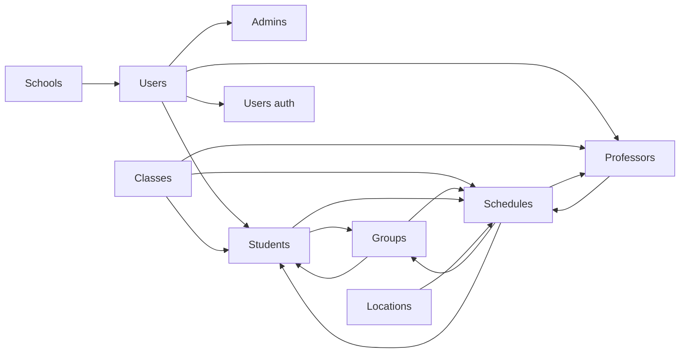

Examples from this project:

- A class rename updates the copies in schedules, students, and professors.
- A student change updates groups and schedules.
- A school rename or status change updates the school memberships stored in every user. That is why the login response and the tenant selector need no school lookup.

#### Caveats

- **Write amplification:** one change fans out to every collection that copies it, and copies can chain (user → student → group → schedule). Keep the projections small. The notification projection of the owner limits what is sent.
- **Consistency:** notifications are delivered synchronously, in the same process, right after the write. A failure in a subscriber is logged and not rolled back, so a failed update leaves a stale copy. The queue-based asynchronous delivery (`broadcast` and `consume` in `base-service.notifications.utils.js`) is a placeholder and is not implemented yet.
- **Copy only what lists need:** fields that are shown in `GET` and rarely change (names, statuses, addresses). Fields that change often should be joined (mode 1) or fetched with the detail request.

### Choosing a mode

The choice is made **per reference**, not per project. A service can copy the class (small, rarely changes, shown in every row) and join the students (large, changes often).

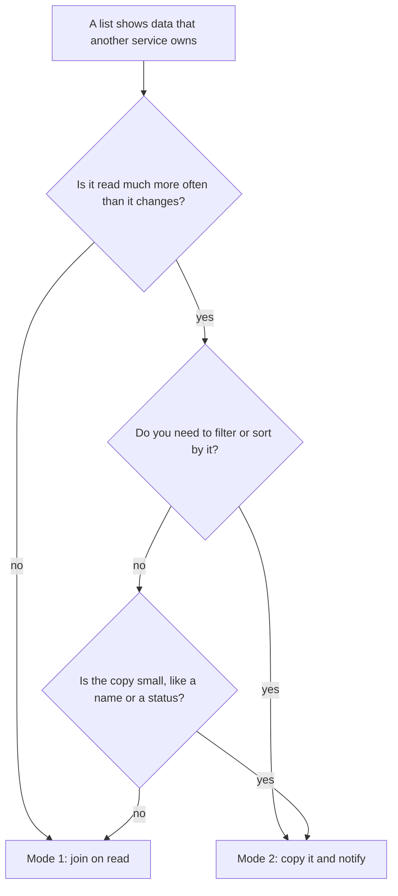

## Local development

Use Node.js, npm, Docker Compose, and MongoDB. Install the backend and the frontend separately:

```sh
cd src && npm install
cd ../ui && npm install
```

### Backend configuration

The backend reads its settings from the **process environment**. [src/.env.example](src/.env.example) is only a template: `src/index.js` does not load a `.env` file, so set the values in your shell, container, or process manager.

| Setting                        | What to set                                                                                                                                                                                              |
| ------------------------------ | -------------------------------------------------------------------------------------------------------------------------------------------------------------------------------------------------------- |
| `SMALL_API_AUTH_PROVIDER_TYPE` | `local` for username and password authentication                                                                                                                                                         |
| Database                       | `SMALL_API_DATABASE_URL` and `SMALL_API_DATABASE_DB`                                                                                                                                                     |
| Secrets                        | the signing and service-to-service secrets from the template                                                                                                                                             |
| SMTP                           | the mail server. Invitations and password setup are sent by email, so it is required                                                                                                                     |
| Server                         | port, public URL, and the CORS origin                                                                                                                                                                    |
| `SMALL_API_PORTAL_SCHOOL_ID`   | a UUID. The Portal School is created with this id at startup if it is missing                                                                                                                            |
| `SMALL_API_PORTAL_ADMIN_EMAIL` | optional. The email of the first portal admin. If the Portal School has no portal admin yet, it is invited at startup and receives the password setup email. See [The Portal School](#the-portal-school) |

### Run it

```sh
cd src && npm run up     # start the local MongoDB container
cd src && npm start      # start the API (after setting the environment)
cd ui && npm run serve   # start the Vue development server (configure ui/.env.example first)
cd ui && npm run build   # production build of the frontend
```

### Tests

```sh
cd src && npm test       # unit tests (Mocha and Sinon), no database needed
cd src && npm run testdb # database-backed tests, needs a running MongoDB test database
```

The fixture credentials in `src/test/test-constants.js` are for tests only. They are not accounts of the application.

## Authentication

The local provider checks a username and password against the local auth collection. **The user must already exist**: users are created by an invitation (or, for the very first portal admin, by the startup setting above), never by a public signup.

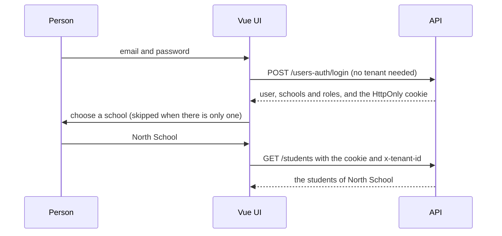

Login does not need a tenant. It returns the school memberships with their statuses and sets the HttpOnly `SmallApp-token` cookie. **The token itself is never returned in the JSON body.**

### UI login

The login component uses the shared API wrapper and processes the response before it opens the tenant selector:

```js
import Api from '../api/api.js';
import { processLoginResponse } from '../auth.js';

const response = await Api.login({ username, password });
const result = await processLoginResponse(response);
```

`Api.login` sends credentials. If the user has one active school, the UI selects it. Otherwise the user chooses. From then on the API wrapper adds the school id as `x-tenant-id`.

### Login with curl

Set the API address, then save the cookie that login returns:

```sh
API='http://localhost:8080/api/v1'
ORIGIN='http://localhost:8081'

curl --include --cookie-jar cookies.txt \
  --header "Origin: $ORIGIN" \
  --header 'Content-Type: application/json' \
  --data '{"username":"user@example.test","password":"your-password"}' \
  "$API/users-auth/login"
```

The response contains `userID`, `username`, `status`, `name`, and `schools`. Pick the id of an active school from `schools` and send it on every tenant request:

```sh
TENANT_ID='school-id-from-login'

curl --cookie cookies.txt \
  --header "Origin: $ORIGIN" \
  --header "x-tenant-id: $TENANT_ID" \
  "$API/students?limit=20&skip=0"
```

To restore the session call `GET /users-auth/me` with the cookie. To log out call `POST /users-auth/logout`.

## API conventions

| Topic          | Rule                                                                                                                                |
| -------------- | ----------------------------------------------------------------------------------------------------------------------------------- |
| Prefixes       | Public routes use `/api/v1`. Internal service routes use `/api/internal_v1` and are not for browsers or third parties               |
| Authentication | The HttpOnly cookie, plus `x-tenant-id` on tenant routes                                                                            |
| Lists          | `GET` on a collection returns `{ data, meta }`, where `meta` has `count`, `limit`, `skip`, and `sort`. A partial list returns `206` |
| Queries        | The `api-query-params` syntax: `limit`, `skip`, `sort`, `projection`, and the filters a service allows                              |
| Input          | The owning service validates the JSON body. Unknown fields and invalid relations are rejected                                       |
| `PATCH`        | Uses `set`, `add`, `remove`, or `unset`, depending on the service. The examples below show relation updates                         |

Example list response:

```json
{
  "data": [{ "id": "class-1", "name": "Mathematics 1A", "status": "active" }],
  "meta": { "count": 1, "limit": 20, "skip": 0 }
}
```

## Walkthrough: from a new school to a schedule

This is the usual order of things, from the point of view of the people involved. The sections below show each call in detail.

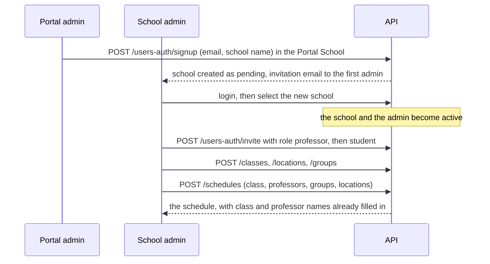

1. **A portal admin creates the school** (the Portal School is the selected tenant). The first admin is invited by email.
2. **The school admin logs in**, sets a password from the email, and selects the school. This activates the admin and the school.
3. **The admin invites people** by role. Each invitation creates (or updates) the user and adds the school membership.
4. **The admin creates the school data:** classes, locations, and groups.
5. **The admin creates schedules** that point to those records. The response and later lists contain the names of the referenced records, as explained in [Data modes](#data-modes-joins-or-notifications).

## Services and examples

All UI examples use the shared `Api` object from `ui/src/api/api.js`. Its Axios instance sends the cookie and selected tenant header automatically. Curl examples use the `API`, `ORIGIN`, `TENANT_ID`, and `cookies.txt` values from [Login with curl](#login-with-curl).

### Schools

There are two kinds of schools. They are listed separately in the API and in the UI, and the [Portal School](#the-portal-school) section explains why.

| Kind              | How it is listed                                                  | How users are added                                                                                                                                       |
| ----------------- | ----------------------------------------------------------------- | --------------------------------------------------------------------------------------------------------------------------------------------------------- |
| Managed schools   | `GET /schools` (portal admins only, the Portal School is omitted) | A school is created with `POST /users-auth/signup`, which also invites its first admin. That admin then invites the others with `POST /users-auth/invite` |
| The Portal School | Not listed. Its admins are listed with `GET /users/portal-admins` | `POST /users-auth/invite` with the role `portal-admin`, while the Portal School is the selected tenant                                                    |

**There is no school-specific "invite admin" route.** Every invitation uses the same `POST /users-auth/invite` flow (`UsersAuthRest.invite`), and the school comes from the selected tenant. A new user receives the signup and password setup email. An existing user receives the invite email.

A new school starts as `pending` and becomes `active` when its first admin logs in. A school can be disabled, and a disabled school is no longer offered in the tenant selector. The Portal School cannot be deleted or disabled, and portal admins cannot delete schools.

```js
// managed schools
await Api.getSchools('limit=20&skip=0');
await Api.signup({ email: 'admin@example.test', school: { name: 'North School', description: 'North campus' } });
await Api.updateSchool('school-id', { name: 'North School', status: 'active' });

// the portal admins (the selected tenant is the Portal School)
await Api.invitePortalAdmin('another-portal-admin@example.test');
await Api.getPortalAdmins('limit=20&skip=0');
await Api.removePortalAdmin('user-id');
```

```sh
# managed schools
curl --cookie cookies.txt -H "Origin: $ORIGIN" -H "x-tenant-id: $TENANT_ID" "$API/schools?limit=20&skip=0"

curl --cookie cookies.txt -H "x-tenant-id: $TENANT_ID" \
  -H "Origin: $ORIGIN" \
  -H 'Content-Type: application/json' \
  --data '{"email":"admin@example.test","school":{"name":"North School","description":"North campus"}}' \
  "$API/users-auth/signup"

# the portal admins ($TENANT_ID is the Portal School)

curl --cookie cookies.txt -H "x-tenant-id: $TENANT_ID" \
  -H "Origin: $ORIGIN" \
  -H 'Content-Type: application/json' \
  --data '{"email":"another-portal-admin@example.test","school":{"role":"portal-admin"}}' \
  "$API/users-auth/invite"

curl --cookie cookies.txt -H "Origin: $ORIGIN" -H "x-tenant-id: $TENANT_ID" "$API/users/portal-admins?limit=20&skip=0"

curl --cookie cookies.txt -H "x-tenant-id: $TENANT_ID" \
  -H "Origin: $ORIGIN" \
  -H 'Content-Type: application/json' -X PATCH \
  --data '{"remove":{"roles":["portal-admin"]}}' \
  "$API/users-auth/school/user/user-id"
```

School status can be edited so disabled schools are unavailable in tenant selection. The Portal School cannot be deleted or disabled. School deletion is not granted to portal admins.

### Admins, Students, and Professors

These records are linked to users. The UI's add action uses the invite endpoint; it does not create an unlinked person record. Invite bodies require the role and selected school context.

| Record    | UI call                                                       | Collection curl                         | Invite role |
| --------- | ------------------------------------------------------------- | --------------------------------------- | ----------- |
| Admin     | `Api.getAdmins(query)` / `Api.createAdmin({ email })`         | `GET "$API/admins?limit=20&skip=0"`     | `admin`     |
| Student   | `Api.getStudents(query)` / `Api.createStudent({ email })`     | `GET "$API/students?limit=20&skip=0"`   | `student`   |
| Professor | `Api.getProfessors(query)` / `Api.createProfessor({ email })` | `GET "$API/professors?limit=20&skip=0"` | `professor` |

Example student invite and collection request:

```sh
curl --cookie cookies.txt -H "x-tenant-id: $TENANT_ID" \
  -H "Origin: $ORIGIN" \
  -H 'Content-Type: application/json' \
  --data '{"email":"student@example.test","school":{"role":"student"}}' \
  "$API/users-auth/invite"

curl --cookie cookies.txt -H "Origin: $ORIGIN" -H "x-tenant-id: $TENANT_ID" "$API/students?limit=20&skip=0"
```

Use the same curl request with `"role":"professor"` or `"role":"admin"` for the other invite types. The table shows each collection request. The entity routers also expose `GET /:id`, `POST /`, `PUT /:id`, `PATCH /:id`, and `DELETE /:id` where allowed by the role matrix; the UI add action intentionally uses invites because these records are linked to user accounts.

Students and professors can be attached to classes through patch operations:

```js
await Api.updateStudentClasses('student-id', ['class-id-to-add'], ['class-id-to-remove']);
await Api.updateProfessorClasses('professor-id', ['class-id-to-add'], []);
```

```sh
curl --cookie cookies.txt -H "x-tenant-id: $TENANT_ID" \
  -H "Origin: $ORIGIN" \
  -H 'Content-Type: application/json' -X PATCH \
  --data '{"add":{"classes":[{"id":"class-id"}]},"remove":{"classes":[]}}' \
  "$API/students/student-id"
```

### Classes

Classes are school-scoped. `required` accepts `required` or `optional`; credits default to zero and status defaults to pending.

```js
await Api.getClasses('limit=20&skip=0');
await Api.createClass({
  name: 'Mathematics 1A',
  description: 'Introductory mathematics',
  credits: 3,
  required: 'required',
});
```

```sh
curl --cookie cookies.txt -H "x-tenant-id: $TENANT_ID" \
  -H "Origin: $ORIGIN" \
  -H 'Content-Type: application/json' \
  --data '{"name":"Mathematics 1A","description":"Introductory mathematics","credits":3,"required":"required"}' \
  "$API/classes"
```

### Locations

Locations require a name and address. Schedules reference a location by ID.

```js
await Api.getLocations('limit=20&skip=0');
await Api.createLocation({ name: 'Room 12', address: 'North building, floor 2' });
```

```sh
curl --cookie cookies.txt -H "x-tenant-id: $TENANT_ID" \
  -H "Origin: $ORIGIN" \
  -H 'Content-Type: application/json' \
  --data '{"name":"Room 12","address":"North building, floor 2"}' \
  "$API/locations"
```

### Groups

Groups contain student references. Membership changes use `add.students` and `remove.students`.

```js
await Api.getGroups('limit=20&skip=0');
await Api.createGroup({ name: 'Group A', description: 'Morning group', students: [{ id: 'student-id' }] });
await Api.updateGroupStudents('group-id', ['student-id-to-add'], []);
```

```sh
curl --cookie cookies.txt -H "x-tenant-id: $TENANT_ID" \
  -H "Origin: $ORIGIN" \
  -H 'Content-Type: application/json' \
  --data '{"name":"Group A","description":"Morning group","students":[{"id":"student-id"}]}' \
  "$API/groups"
```

### Schedules

A schedule belongs to one class and can refer to professors, groups, and students. Each schedule time includes an ISO timestamp, frequency, location ID, and optional status. Supported frequencies are `once`, `weekly`, `biWeekly`, and `monthly`.

```js
await Api.getSchedules('limit=20&skip=0');
await Api.createSchedule({
  name: 'Mathematics 1A - Monday',
  class: 'class-id',
  schedules: [
    { timestamp: '2026-11-16T09:00:00.000Z', frequency: 'weekly', location: 'location-id', status: 'active' },
  ],
  professors: [{ id: 'professor-id' }],
  groups: [{ id: 'group-id' }],
  students: [],
});
```

```sh
curl --cookie cookies.txt -H "x-tenant-id: $TENANT_ID" \
  -H "Origin: $ORIGIN" \
  -H 'Content-Type: application/json' \
  --data '{"name":"Mathematics 1A - Monday","class":"class-id","schedules":[{"timestamp":"2026-11-16T09:00:00.000Z","frequency":"weekly","location":"location-id","status":"active"}],"professors":[{"id":"professor-id"}],"groups":[{"id":"group-id"}],"students":[]}' \
  "$API/schedules"
```

Relationship changes use `Api.updateScheduleInnerSchedules`, `Api.updateScheduleGroups`, `Api.updateScheduleProfessors`, and `Api.updateScheduleStudents`; each helper issues a `PATCH /schedules/:id` with `add` and `remove` arrays.

### Users

Users are global profile records referenced by school-backed person records. Access to other users is role-limited; a user can also access their own profile.

```js
await Api.getUser('user-id');
await Api.updateUser('user-id', { name: 'Updated Name' });
```

```sh
curl --cookie cookies.txt -H "Origin: $ORIGIN" -H "x-tenant-id: $TENANT_ID" "$API/users/user-id"
```

### Users Auth

In addition to login, logout, and `GET /users-auth/me`, the service provides `POST /users-auth/invite`, `POST /users-auth/reset-password`, `PUT /users-auth/password`, `PUT /users-auth/id`, and `PATCH /users-auth/school/user/:uid`. Signup is restricted to portal admins; invite is available to school admins (for their selected school) and to portal admins (for the Portal School). Internal auth routes are not public APIs.

```js
await Api.invite({ email: 'student@example.test', school: { role: 'student' } });
await Api.updateUserPassword({ oldPassword, newPassword });
```

```sh
curl --cookie cookies.txt -H "x-tenant-id: $TENANT_ID" \
  -H "Origin: $ORIGIN" \
  -H 'Content-Type: application/json' \
  --data '{"username":"user@example.test"}' \
  "$API/users-auth/reset-password"
```

The local auth provider sends a signup/password setup message to a newly created user and an invitation message to an existing user. SMTP settings and localized email templates are required for delivery.

### Events

Events are raised by services after mutations. Public clients can query events but cannot create them directly; event creation and notification endpoints are internal.

```js
await Api.getEvents('limit=20&skip=0');
```

```sh
curl --cookie cookies.txt -H "Origin: $ORIGIN" -H "x-tenant-id: $TENANT_ID" "$API/events?limit=20&skip=0"
```

## Code map

| Area                                                          | Location                                                     |
| ------------------------------------------------------------- | ------------------------------------------------------------ |
| Service startup and configuration                             | `src/index.js`, `src/services/config.services.js`            |
| Role-to-route policy                                          | `src/services/config.roles.json`                             |
| Domain service modules                                        | `src/services/<service>/`                                    |
| Service-to-service REST wrappers                              | `src/services/rest/`                                         |
| Shared MongoDB, validation, references, events, notifications | `src/core/utils/`                                            |
| Authentication and invitation flows                           | `src/services/users-auth/`                                   |
| Web server, middleware, and security headers                  | `src/web-server/`, `src/core/web-server/`                    |
| Backend tests                                                 | `src/test/test/` and `src/core/test/`                        |
| Vue API client and role-derived permissions                   | `ui/src/api/`, `ui/src/auth.js`                              |
| Vue pages and shared tables                                   | `ui/src/components/`                                         |
| Vue routing and tenant selection                              | `ui/src/router/`, `ui/src/components/base.tenant.select.vue` |
