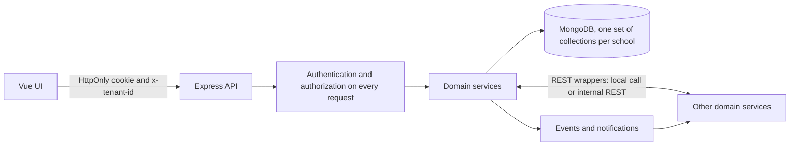
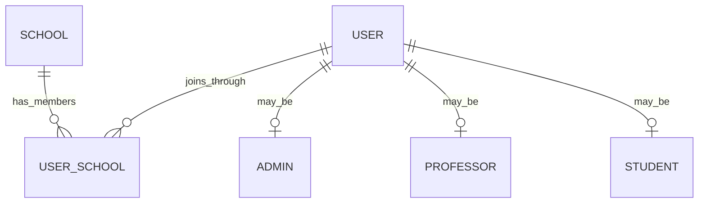
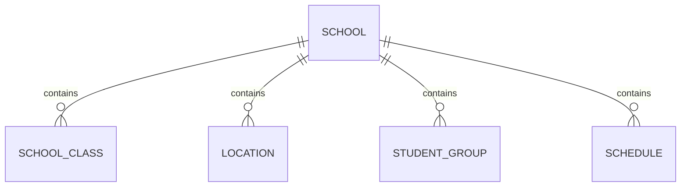
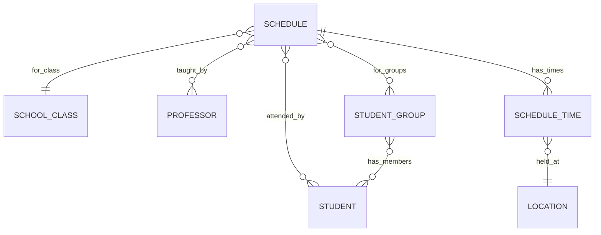
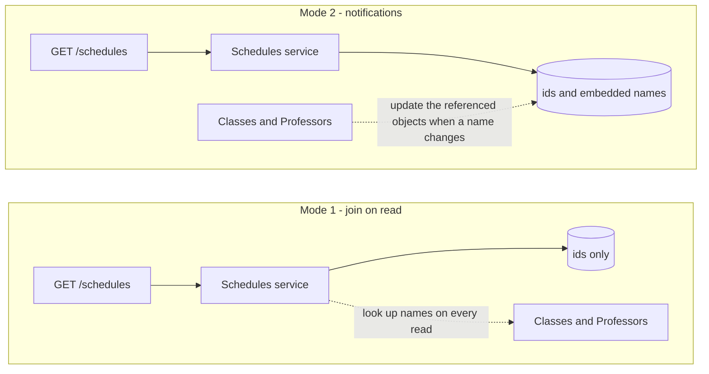
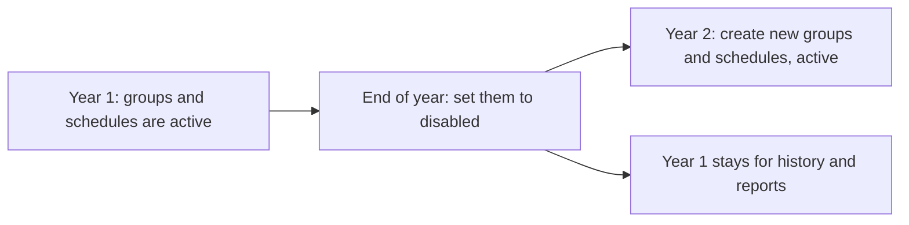
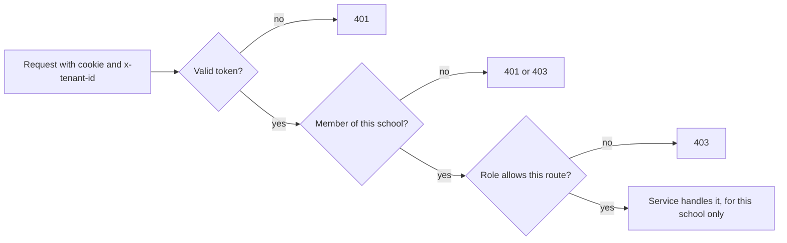
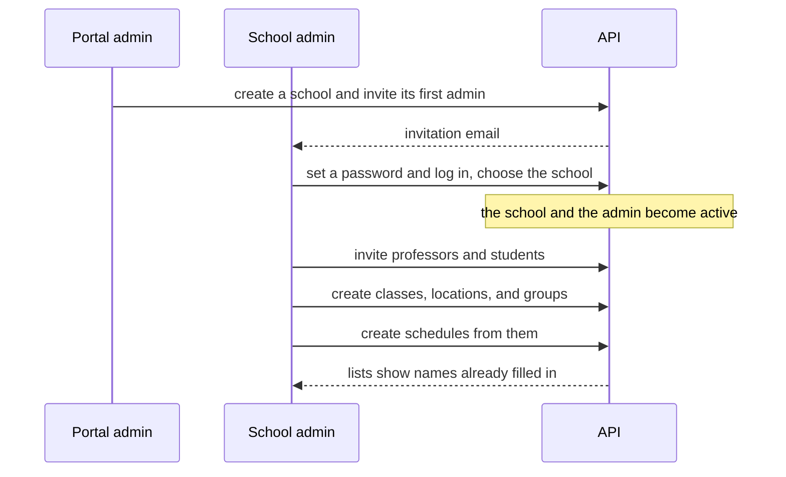

# small-nodejs-service

**Many schools, one portal.** A Node.js backend and a Vue application that let one platform run any number of schools, each with its own data, people, and timetable, and let one person belong to several schools with a different role in each.

It is deliberately small, and it goes deep where small examples stop: real multi-tenancy, per-school roles, invitations, a portal that administers the schools without seeing inside them, schedules built from classes, groups, professors, and locations, and the design choices that keep all of it consistent.

> This document is the overview: what the project is, the ideas behind it, and how it keeps itself safe. Everything about the implementation (API, flows with examples, configuration, local development, code map) is in the **[detailed documentation](README.details.md)**.

## Contents

- [What it brings](#what-it-brings)
- [Purpose and status](#purpose-and-status)
- [Architecture at a glance](#architecture-at-a-glance)
- [The ideas behind it](#the-ideas-behind-it)
- [Roles and who sees what](#roles-and-who-sees-what)
- [The Portal School](#the-portal-school)
- [Security first](#security-first)
- [Key flows](#key-flows)
- [Design decisions](#design-decisions)
- [How it is verified](#how-it-is-verified)
- [Getting started](#getting-started)
- [Documentation](#documentation)

## What it brings

| Feature                        | In short                                                                                                                          |
| ------------------------------ | --------------------------------------------------------------------------------------------------------------------------------- |
| **Multi-tenant**               | Every school is a tenant. A school's data is separate from every other school's, and a request always says which school it is for |
| **People in many schools**     | One account, many schools, a different role in each (admin, professor, student)                                                   |
| **A portal on top**            | Portal admins create and manage schools, but cannot see what is inside them                                                       |
| **Invitation only**            | Nobody signs up on their own. Admins invite, and the portal admin invites other portal admins                                     |
| **Complete school flows**      | Classes, locations, groups, students, professors, and schedules with inner time slots, frequencies, and locations                 |
| **Status instead of deletion** | `pending`, `active`, `disabled` on schools, users, and school records, so a school year can be closed without losing history      |
| **Traceable changes**          | Every record has a creation time, a last-modified time, and a change counter                                                      |
| **Fast reads by design**       | Related data is embedded in the records that display it, and kept current by notifications                                        |
| **Two data modes**             | Join on read, or embed on write with notifications, chosen per relationship                                                       |
| **Zero-trust security**        | Every request is authenticated and authorized, every service call is authenticated, the cookie is HttpOnly                        |
| **Events and audit**           | Changes raise events that school admins can read                                                                                  |
| **Bilingual UI**               | English and Romanian                                                                                                              |

## Purpose and status

This is an **academic project**: a reference for how to build a multi-tenant system with real flows, not a toy. Many examples stop at a single table and a login form. This one keeps going, with the invitation lifecycle, role changes, the school year, data that depends on other data, and the rules for who may see what.

If you run it in production, **monitor it** (health, errors, latency, the database, and mail delivery) and size it for your load; the [sizing guide](README.details.md#sizing-guide) says what to watch and what to tune first.

## Architecture at a glance



- **UI and API** are separate. The UI never decides what a user may do; it only hides and guards for convenience.
- **Domain services** (schools, users, users-auth, admins, students, professors, classes, locations, groups, schedules, events) each own their data and talk to each other only through REST wrappers. The same code runs as one process or as several.
- **MongoDB** holds a set of collections per school, which is how a school's data stays separate.

## The ideas behind it

### Multi-tenancy

A **tenant is a school**. Each request names its school in the `x-tenant-id` header, and the API checks that the logged-in user is a member of that school before anything else. Data is stored in per-school collections chosen from the verified tenant.

### Users are global, roles belong to a school

A user is one identity. The list of schools they belong to, and their roles in each, is stored on the user. The same person can be an admin in one school and a professor and a student in another, and the school they pick decides which role applies.

### Relationships

**People and schools.** A user joins schools through memberships. Admin, professor, and student records are the school's record of a user.



**What a school holds.** Four kinds of records belong to a school.



**A schedule.** It points to a class, professors, groups, and students, and has time slots that each point to a location. A group points to its students.



`USER_SCHOOL` (the memberships stored in the user) and `SCHEDULE_TIME` (the times stored in the schedule) are embedded, not separate collections.

### References are embedded

When a list shows a schedule it shows the **names** of its class, professors, and groups, not just their ids. So the referenced data is **embedded** in the record that displays it (a few fields: id, name, status, and what the list needs). A list is then one read of one collection, and the referenced objects can be filtered and sorted in the database. When the source changes, a notification updates the referenced objects.

There are **two modes**, chosen per relationship:



|                | Join on read                | Notifications                                                   |
| -------------- | --------------------------- | --------------------------------------------------------------- |
| Reads          | extra lookups on every read | one read                                                        |
| Changes        | only the changed record     | the owner notifies, subscribers update their referenced objects |
| Always current | yes                         | once the notification is processed                              |
| Best when      | data changes often          | data rarely changes and reads dominate                          |

Embed a class name (read thousands of times for each rename). Join something that changes as often as it is read. The system ships wired for notifications; [Data modes](README.details.md#data-modes-joins-or-notifications) explains both and how to configure them.

### Status controls what is current

Schools, users, classes, locations, groups, and schedules carry a **status**. Instead of deleting, a school **disables** what it no longer uses. A typical school year:



Lists and selectors of the new year show only what is active, and nothing from the old year is lost.

### Every record tracks its changes

Every document has `createdTimestamp`, `lastModifiedTimestamp`, and `modifiedCount`, a counter incremented on every change. Because services update each other's referenced objects **asynchronously**, two changes can arrive in either order. The counter lets a consumer tell which version of a record it has seen, which is the basis for ordering updates and for not overriding a newer value with an older one.

### Users can be deleted, their traces stay

A person can delete their account: the account is deleted. The records they leave in schools (admin, professor, student) and the events that name them **stay, marked deleted**, so a school's history is not rewritten. Removing someone from a school is a different action: an admin removes the role, the account is untouched, and the record stays marked removed. Each school chooses whether it keeps these traces or deletes them:

- **A university keeps them.** Year after year a student joins new groups and new schedules, with new professors, and is graded in classes that end. When a student leaves (or a professor), the groups, the schedules, and the grades of past years must still show who was there: the traces keep that history true.
- **A sports gym deletes them.** Someone joins a training group and a schedule; when they leave, nothing about them is needed anymore, so the record is deleted, with its entries in the groups and the schedules.

## Roles and who sees what

| Role           | Where             | Sees and does                                                                                                                                                |
| -------------- | ----------------- | ------------------------------------------------------------------------------------------------------------------------------------------------------------ |
| `portal-admin` | the Portal School | Creates schools, invites their first admin, manages the portal admins. **Cannot see inside a school**: no students, groups, classes, locations, or schedules |
| `admin`        | a school          | Manages everything inside the school and invites its people                                                                                                  |
| `professor`    | a school          | Reads the school data needed to teach                                                                                                                        |
| `student`      | a school          | Reads the school data needed to attend                                                                                                                       |
| any member     | their own account | Their own profile                                                                                                                                            |

The principle is **the minimum each person needs**: a student sees only the minimum and mostly nothing about other students, and a professor sees the list of their own students. The exact routes of each role are in one file, `src/services/config.roles.json`. The [detailed documentation](README.details.md#who-can-see-what) shows the current access matrix.

## The Portal School

A platform needs somewhere to keep its own administrators. Instead of a special case, it is **a school like the others**: users select it after login, and inviting a user to it makes them a portal admin.

- It is created automatically at startup. Its id is backend configuration and never appears in the UI.
- It is always active, cannot be deleted, and is not in the list of managed schools.
- Two rules keep it apart from normal schools: `portal-admin` can only be given on the Portal School, and nothing else can be given there.
- The first portal admin is invited at startup from one environment variable, through the normal invite flow, so no password is configured anywhere.

## Security first

The model is **zero trust**: nothing is trusted because of where it comes from, what the UI shows, or what an earlier request proved.

- **Every request** is authenticated (an HttpOnly cookie that scripts cannot read) and authorized (membership of the tenant, then the role's permission for that exact route).
- **Service to service** calls are authenticated too. Between processes each call carries a short-lived signed token, and internal routes refuse calls without it.
- **Multi-tenant isolation:** a school's data is in its own collections, chosen from the verified tenant.
- **Closed by design:** nobody signs up on their own. Only admins invite, and only a portal admin creates a school or another portal admin.
- **The portal sees the schools, not inside them.**
- **Validate everything:** every body is checked against a schema, unknown fields are rejected, and list filters accept only the fields a service declares.
- **Defense in depth:** CORS allow-list, security headers, HTTPS in production, cross-site request protection, login rate limits, a password policy, and no stack traces in production responses.
- **No secrets in the UI**, and the Portal School's id never ships to the browser.

The [security model](README.details.md#security-model) lists each layer and the checks that were run against it.

## Key flows

**Every request** is checked the same way before it reaches any business code:



**From a new school to a working timetable:**



The [walkthrough](README.details.md#walkthrough-from-a-new-school-to-a-schedule) shows each of these calls.

## Design decisions

| Decision                                                  | Why                                                                                                           |
| --------------------------------------------------------- | ------------------------------------------------------------------------------------------------------------- |
| Every school is a tenant, **including the Portal School** | One access model for everything; a portal admin is just a membership with a special role                      |
| Roles live on the **membership**, not on the user         | The same person can be professor here and student there                                                       |
| References are **embedded**                               | List reads are one read of one collection and can filter and sort on referenced fields                        |
| **Two data modes**, chosen per relationship               | Embed what is read often and changes rarely; join the rest                                                    |
| **Status instead of deletion**                            | Close a school year without losing history                                                                    |
| **Only admins invite**                                    | A closed system for schools: nobody joins unless a responsible person adds them                               |
| **Zero trust, service to service included**               | A compromised or mistaken caller cannot reach more than it should                                             |
| HttpOnly **cookie**, not a token in JavaScript            | An injected script cannot steal the session                                                                   |
| **Not a queue for every call**                            | Login and reads are latency-sensitive; background work (notifications, email, imports) is what a queue is for |

Each decision, with its trade-off, is in [Design decisions](README.details.md#design-decisions).

## How it is verified

- **Unit tests:** about 1,500 Mocha tests, with Sinon stubs for service dependencies, in one suite per service. They cover all the application code, and they set their own settings: nothing of the shell or of the machine is used.
- **Functional tests** against a real MongoDB are separate (`npm run testdb`): the operations of the services, and the flows of the accounts through the API (login, signup, invite, the remove of a role, the delete of an account and its invitation again, the expiry of the invitations).
- **Independent reviews** were run for security, adversarial behaviour, flow correctness, concurrency, and scalability, with runnable scripts. Their conclusions feed the [security model](README.details.md#security-model), the [sizing guide](README.details.md#sizing-guide), and the [design invariants](README.design-invariants.md): the promises of the design, each with the check that proves it. The method is the [review guide](README.review-guide.md).

## Getting started

You need Node.js, npm, Docker Compose, and MongoDB.

```sh
cd src && npm ci && cd ../ui && npm ci              # install both parts (from the lockfiles)
cd ../src && npm run up                              # local MongoDB container
cd ../src && npm start                               # the API, after setting the environment
cd ../ui && npm run serve                            # the UI development server
```

The API reads its settings from the process environment: database, secrets, mail server, the Portal School's id, and optionally the first portal admin's email. The full list, the UI configuration, and how to log in are in [Local development](README.details.md#local-development) and [Authentication](README.details.md#authentication).

## Documentation

| Where                                                      | What                                                                                                                                                                                                                                                |
| ---------------------------------------------------------- | --------------------------------------------------------------------------------------------------------------------------------------------------------------------------------------------------------------------------------------------------- |
| **[README.details.md](README.details.md)**                 | The details: access model, statuses, security model, design decisions, both data modes with configuration, sizing guide, local development, authentication, API conventions, a walkthrough, every service with UI and curl examples, and a code map |
| [README.design-invariants.md](README.design-invariants.md) | The promises of the design, each with the check that proves it, and the caveats                                                                                                                                                                     |
| [README.review-guide.md](README.review-guide.md)           | How to review it: security, adversarial, flows, concurrency, scalability, documentation, and the regression pass                                                                                                                                    |
| [docs/design.md](docs/design.md)                           | How it is built: layers, the anatomy of a service, how services talk to each other, and how to extend it                                                                                                                                            |
| [docs/testing.md](docs/testing.md)                         | How to test it: kinds of tests, how to run and write them, and what a change must cover                                                                                                                                                             |
| [docs/security.md](docs/security.md)                       | The security model, where it is enforced, and (to be added) the hardening guide                                                                                                                                                                     |
| [src/.env.example](src/.env.example)                       | The backend settings                                                                                                                                                                                                                                |
| `src/services/config.roles.json`                           | Which role may call which route                                                                                                                                                                                                                     |
| `src/services/config.services.js`                          | Services and the notifications between them                                                                                                                                                                                                         |
