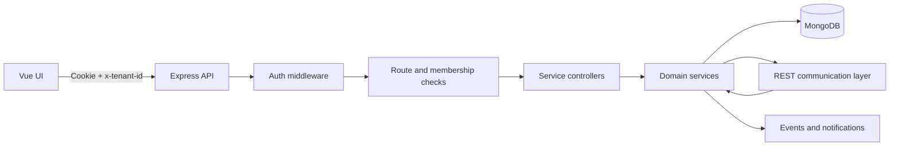

# small-nodejs-service

A Node.js microservice and Vue application for managing multiple schools from one portal.

The service demonstrates a multi-tenant school domain where users can hold different roles in different schools. Its backend provides REST controllers, service-to-service communication, MongoDB persistence, role-based authentication, reference expansion, notifications, translations, email flows, and unit tests.

## Project Overview

The backend is an Express application in `src/`. The Vue 3 frontend is in `ui/`. Backend services use MongoDB; user-facing authentication uses an HttpOnly cookie. The selected school is sent as `x-tenant-id` on tenant-scoped requests.



## Domain Model

Users are global identities. Their roles are attached to school memberships, not to the user globally. Students, professors, and admins are user-backed school records. Classes, locations, groups, and schedules belong to a school; groups and schedules refer to other records by ID.

```mermaid
erDiagram
  SCHOOL ||--o{ USER_SCHOOL : has
  USER ||--o{ USER_SCHOOL : joins
  USER ||--o| ADMIN : may_have
  USER ||--o| STUDENT : may_have
  USER ||--o| PROFESSOR : may_have
  SCHOOL ||--o{ CLASS : contains
  SCHOOL ||--o{ LOCATION : contains
  SCHOOL ||--o{ GROUP : contains
  SCHOOL ||--o{ SCHEDULE : contains
  CLASS ||--o{ SCHEDULE : scheduled_as
  LOCATION ||--o{ SCHEDULE_LOCATION : hosts
  SCHEDULE ||--o{ SCHEDULE_LOCATION : has_times
  PROFESSOR ||--o{ SCHEDULE : teaches
  GROUP ||--o{ SCHEDULE : participates
  STUDENT ||--o{ GROUP : member_of
  STUDENT ||--o{ SCHEDULE : attends
```

`USER_SCHOOL` and `SCHEDULE_LOCATION` describe embedded membership/reference data, not separate MongoDB collections.

`admin`, `professor`, and `student` are school roles. `portal-admin` is a separate role stored on a membership in the Portal School. A portal admin does not also need the school-level `admin` role. The Portal School is configured only on the backend, must remain active, and is omitted from the managed-school list.

## Design Principles

- **Tenant context:** authenticated tenant requests must include an active school membership in `x-tenant-id`. Controllers receive the resolved context as `req._ctx`; tenant-scoped services validate required context before database access.
- **Authorization:** `src/services/config.roles.json` maps HTTP routes to roles. The auth service checks both the route and the user's role in the selected school. The UI hides privileged navigation and guards routes for usability, but backend authorization is authoritative.
- **Layered services:** routers register routes, controllers translate HTTP, services validate and orchestrate domain behavior, database modules provide collections/indexes, and `src/services/rest/` wraps inter-service calls.
- **Shared persistence helpers:** services use Joi schemas, `RestApiUtils` for list filters, `DbOpsUtils` for MongoDB operations, and reference utilities for resolving related records.
- **Events and notifications:** successful mutations raise domain events and notifications. Subscribers update dependent service records; internal notification routes are not public client APIs.
- **Internal communication:** services call other services through `RestCommsUtils`, using local dispatch or the internal REST route and service-to-service authentication.
- **Status lifecycle:** records use `pending`, `active`, and `disabled` states where applicable. A first successful login activates pending user/school records. The tenant selector offers only active schools.
- **Translations and email:** response fields are translated through the translation utilities; localized strings and email templates live in `src/translations/`.
- **Authentication:** browser clients send the HttpOnly cookie automatically. Do not copy the auth token into a JavaScript `Authorization` header.
- **Transport and abuse controls:** CORS uses the configured origin allowlist with credentials; the web server adds security headers; login is limited to three attempts per IP per 15-minute window outside debug mode.
- **Password policy:** newly set passwords require at least eight characters with uppercase, lowercase, a digit, and a special character. Password and email changes require the current password.
- **Tests:** Mocha tests use Sinon stubs for service dependencies and follow the per-service suites in `src/test/test/`. Database-backed functional tests are separate from the default unit suite.

## Local Development

Use Node.js, npm, Docker Compose, and MongoDB. Backend and frontend dependencies are installed separately:

```sh
cd src && npm install
cd ../ui && npm install
```

The backend requires the values shown in [src/.env.example](src/.env.example). That file is a template: `src/index.js` reads values from the process environment and does not load `.env` itself. Configure the values in your shell, container, or process manager. In particular:

- Set `SMALL_API_AUTH_PROVIDER_TYPE=local` for local username/password authentication.
- Set database URL, database name, signing secrets, SMTP configuration, port, URL, and CORS origin.
- Set `SMALL_API_PORTAL_SCHOOL_ID` to a UUID. Startup creates the active Portal School record if it is missing.
- Provision the first Portal School user with the `portal-admin` membership role through a trusted operator/bootstrap process. There is intentionally no anonymous portal-admin signup.

Start the local MongoDB container from `src/`:

```sh
cd src && npm run up
```

After supplying the backend environment values, start the API:

```sh
cd src && npm start
```

For UI development, configure [ui/.env.example](ui/.env.example) and run:

```sh
cd ui && npm run serve
```

The Vue development server uses the configured UI port and API URL. For a production frontend build, run `npm run build` in `ui/`.

Run backend tests from `src/`:

```sh
npm test
```

The database-backed suite is `npm run testdb` and requires a running MongoDB test database. Local test fixture credentials in `src/test/test-constants.js` are for tests only; they are not provisioned application accounts.

## Authentication First

The local provider authenticates a username and password against the local auth collection. A user must already exist, normally through an invitation or a trusted bootstrap. Login does not require a tenant header. It returns the user's school memberships and their current statuses, then sets the HttpOnly `SmallApp-token` cookie; the token itself is not returned in JSON.

### UI Login

The login component uses the shared API wrapper and processes the response before navigating to the tenant selector:

```js
import Api from '../api/api.js';
import { processLoginResponse } from '../auth.js';

const response = await Api.login({ username, password });
const result = await processLoginResponse(response);
```

`Api.login` enables credentialed requests. If the user has one active school, the UI selects it; otherwise the user chooses an active school. The API wrapper then adds that school ID as `x-tenant-id` on subsequent requests.

### Local Login with curl

Set the API URL for your local backend, then save the cookie returned by login:

```sh
API='http://localhost:8080/api/v1'
ORIGIN='http://localhost:8081'

curl --include --cookie-jar cookies.txt \
  --header "Origin: $ORIGIN" \
  --header 'Content-Type: application/json' \
  --data '{"username":"user@example.test","password":"your-password"}' \
  "$API/users-auth/login"
```

The response body includes `userID`, `username`, `status`, `name`, and `schools`. Choose an active membership ID from `schools`; use it on every tenant-scoped request:

```sh
TENANT_ID='school-id-from-login'

curl --cookie cookies.txt \
  --header "Origin: $ORIGIN" \
  --header "x-tenant-id: $TENANT_ID" \
  "$API/students?limit=20&skip=0"
```

To restore the current session, call `GET /users-auth/me` with the cookie. To log out, call `POST /users-auth/logout` with the cookie.

## API Conventions

- Public routes use the `/api/v1` prefix. Internal service routes use `/api/internal_v1` and are not for browser or third-party clients.
- Authenticated requests use the HttpOnly cookie and, for tenant-scoped routes, `x-tenant-id`.
- Collection GET responses contain `data` and `meta` (`count`, `limit`, `skip`, and `sort`). A partial collection may return HTTP `206`.
- List queries support the `api-query-params` syntax used by the backend, including `limit`, `skip`, `sort`, `projection`, and supported field filters.
- JSON request bodies are validated by the owning service. Unknown fields and invalid relationships are rejected.
- `PATCH` uses service-specific `set`, `add`, `remove`, or `unset` structures. See the examples below for relationship updates.

## Services and Examples

All UI examples use the shared `Api` object from `ui/src/api/api.js`. Its Axios instance sends the cookie and selected tenant header automatically. Curl examples use the `API`, `TENANT_ID`, and `cookies.txt` values from the login section.

### Schools

Portal admins can list and edit managed schools. The Portal School itself is not returned. Create a school through the existing `POST /users-auth/signup` flow; it creates the school through `SchoolsRest` and invites the first school admin. New users receive the signup/password setup email, while existing users receive the invite email.

```js
await Api.getSchools('limit=20&skip=0');
await Api.signup({ email: 'admin@example.test', school: { name: 'North School', description: 'North campus' } });
await Api.inviteSchoolAdmin('school-id', 'another-admin@example.test');
await Api.updateSchool('school-id', { name: 'North School', status: 'active' });
```

```sh
curl --cookie cookies.txt -H "Origin: $ORIGIN" -H "x-tenant-id: $TENANT_ID" "$API/schools?limit=20&skip=0"

curl --cookie cookies.txt -H "x-tenant-id: $TENANT_ID" \
  -H "Origin: $ORIGIN" \
  -H 'Content-Type: application/json' \
  --data '{"email":"admin@example.test","school":{"name":"North School","description":"North campus"}}' \
  "$API/users-auth/signup"

curl --cookie cookies.txt -H "x-tenant-id: $TENANT_ID" \
  -H "Origin: $ORIGIN" \
  -H 'Content-Type: application/json' \
  --data '{"email":"another-admin@example.test"}' \
  "$API/schools/school-id/admins"
```

School status can be edited so disabled schools are unavailable in tenant selection. The Portal School cannot be deleted or disabled. School deletion is not granted to portal admins.

### Admins, Students, and Professors

These records are linked to users. The UI's add action uses the invite endpoint; it does not create an unlinked person record. Invite bodies require the role and selected school context.

| Record    | UI call                                                       | Collection curl                         | Invite role |
| --------- | ------------------------------------------------------------- | --------------------------------------- | ----------- |
| Admin     | `Api.getAdmins(query)` / `Api.createAdmin({ email })`         | `GET "$API/admins?limit=20&skip=0"`     | `admin`     |
| Student   | `Api.getStudents(query)` / `Api.createStudent({ email })`     | `GET "$API/students?limit=20&skip=0"`   | `student`   |
| Professor | `Api.getProfessors(query)` / `Api.createProfessor({ email })` | `GET "$API/professors?limit=20&skip=0"` | `professor` |

Example student invite and collection request:

```sh
curl --cookie cookies.txt -H "x-tenant-id: $TENANT_ID" \
  -H "Origin: $ORIGIN" \
  -H 'Content-Type: application/json' \
  --data '{"email":"student@example.test","school":{"role":"student"}}' \
  "$API/users-auth/invite"

curl --cookie cookies.txt -H "Origin: $ORIGIN" -H "x-tenant-id: $TENANT_ID" "$API/students?limit=20&skip=0"
```

Use the same curl request with `"role":"professor"` or `"role":"admin"` for the other invite types. The table shows each collection request. The entity routers also expose `GET /:id`, `POST /`, `PUT /:id`, `PATCH /:id`, and `DELETE /:id` where allowed by the role matrix; the UI add action intentionally uses invites because these records are linked to user accounts.

Students and professors can be attached to classes through patch operations:

```js
await Api.updateStudentClasses('student-id', ['class-id-to-add'], ['class-id-to-remove']);
await Api.updateProfessorClasses('professor-id', ['class-id-to-add'], []);
```

```sh
curl --cookie cookies.txt -H "x-tenant-id: $TENANT_ID" \
  -H "Origin: $ORIGIN" \
  -H 'Content-Type: application/json' -X PATCH \
  --data '{"add":{"classes":[{"id":"class-id"}]},"remove":{"classes":[]}}' \
  "$API/students/student-id"
```

### Classes

Classes are school-scoped. `required` accepts `required` or `optional`; credits default to zero and status defaults to pending.

```js
await Api.getClasses('limit=20&skip=0');
await Api.createClass({
  name: 'Mathematics 1A',
  description: 'Introductory mathematics',
  credits: 3,
  required: 'required',
});
```

```sh
curl --cookie cookies.txt -H "x-tenant-id: $TENANT_ID" \
  -H "Origin: $ORIGIN" \
  -H 'Content-Type: application/json' \
  --data '{"name":"Mathematics 1A","description":"Introductory mathematics","credits":3,"required":"required"}' \
  "$API/classes"
```

### Locations

Locations require a name and address. Schedules reference a location by ID.

```js
await Api.getLocations('limit=20&skip=0');
await Api.createLocation({ name: 'Room 12', address: 'North building, floor 2' });
```

```sh
curl --cookie cookies.txt -H "x-tenant-id: $TENANT_ID" \
  -H "Origin: $ORIGIN" \
  -H 'Content-Type: application/json' \
  --data '{"name":"Room 12","address":"North building, floor 2"}' \
  "$API/locations"
```

### Groups

Groups contain student references. Membership changes use `add.students` and `remove.students`.

```js
await Api.getGroups('limit=20&skip=0');
await Api.createGroup({ name: 'Group A', description: 'Morning group', students: [{ id: 'student-id' }] });
await Api.updateGroupStudents('group-id', ['student-id-to-add'], []);
```

```sh
curl --cookie cookies.txt -H "x-tenant-id: $TENANT_ID" \
  -H "Origin: $ORIGIN" \
  -H 'Content-Type: application/json' \
  --data '{"name":"Group A","description":"Morning group","students":[{"id":"student-id"}]}' \
  "$API/groups"
```

### Schedules

A schedule belongs to one class and can refer to professors, groups, and students. Each schedule time includes an ISO timestamp, frequency, location ID, and optional status. Supported frequencies are `once`, `weekly`, `biWeekly`, and `monthly`.

```js
await Api.getSchedules('limit=20&skip=0');
await Api.createSchedule({
  name: 'Mathematics 1A - Monday',
  class: 'class-id',
  schedules: [
    { timestamp: '2026-11-16T09:00:00.000Z', frequency: 'weekly', location: 'location-id', status: 'active' },
  ],
  professors: [{ id: 'professor-id' }],
  groups: [{ id: 'group-id' }],
  students: [],
});
```

```sh
curl --cookie cookies.txt -H "x-tenant-id: $TENANT_ID" \
  -H "Origin: $ORIGIN" \
  -H 'Content-Type: application/json' \
  --data '{"name":"Mathematics 1A - Monday","class":"class-id","schedules":[{"timestamp":"2026-11-16T09:00:00.000Z","frequency":"weekly","location":"location-id","status":"active"}],"professors":[{"id":"professor-id"}],"groups":[{"id":"group-id"}],"students":[]}' \
  "$API/schedules"
```

Relationship changes use `Api.updateScheduleInnerSchedules`, `Api.updateScheduleGroups`, `Api.updateScheduleProfessors`, and `Api.updateScheduleStudents`; each helper issues a `PATCH /schedules/:id` with `add` and `remove` arrays.

### Users

Users are global profile records referenced by school-backed person records. Access to other users is role-limited; a user can also access their own profile.

```js
await Api.getUser('user-id');
await Api.updateUser('user-id', { name: 'Updated Name' });
```

```sh
curl --cookie cookies.txt -H "Origin: $ORIGIN" -H "x-tenant-id: $TENANT_ID" "$API/users/user-id"
```

### Users Auth

In addition to login, logout, and `GET /users-auth/me`, the service provides `POST /users-auth/invite`, `POST /users-auth/reset-password`, `PUT /users-auth/password`, `PUT /users-auth/id`, and `PATCH /users-auth/school/user/:uid`. Signup is restricted to portal admins. Internal auth routes are not public APIs.

```js
await Api.invite({ email: 'student@example.test', school: { role: 'student' } });
await Api.updateUserPassword({ oldPassword, newPassword });
```

```sh
curl --cookie cookies.txt -H "x-tenant-id: $TENANT_ID" \
  -H "Origin: $ORIGIN" \
  -H 'Content-Type: application/json' \
  --data '{"username":"user@example.test"}' \
  "$API/users-auth/reset-password"
```

The local auth provider sends a signup/password setup message to a newly created user and an invitation message to an existing user. SMTP settings and localized email templates are required for delivery.

### Events

Events are raised by services after mutations. Public clients can query events but cannot create them directly; event creation and notification endpoints are internal.

```js
await Api.getEvents('limit=20&skip=0');
```

```sh
curl --cookie cookies.txt -H "Origin: $ORIGIN" -H "x-tenant-id: $TENANT_ID" "$API/events?limit=20&skip=0"
```

## Code Map

| Area                                                          | Location                                                     |
| ------------------------------------------------------------- | ------------------------------------------------------------ |
| Service startup and configuration                             | `src/index.js`, `src/services/config.services.js`            |
| Role-to-route policy                                          | `src/services/config.roles.json`                             |
| Domain service modules                                        | `src/services/<service>/`                                    |
| Service-to-service REST wrappers                              | `src/services/rest/`                                         |
| Shared MongoDB, validation, references, events, notifications | `src/core/utils/`                                            |
| Authentication and invitation flows                           | `src/services/users-auth/`                                   |
| Web server, middleware, and security headers                  | `src/web-server/`, `src/core/web-server/`                    |
| Backend tests                                                 | `src/test/test/` and `src/core/test/`                        |
| Vue API client and role-derived permissions                   | `ui/src/api/`, `ui/src/auth.js`                              |
| Vue pages and shared tables                                   | `ui/src/components/`                                         |
| Vue routing and tenant selection                              | `ui/src/router/`, `ui/src/components/base.tenant.select.vue` |
