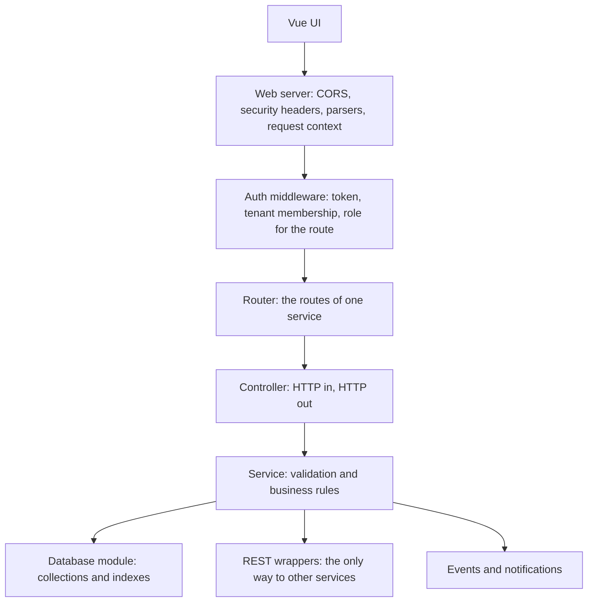
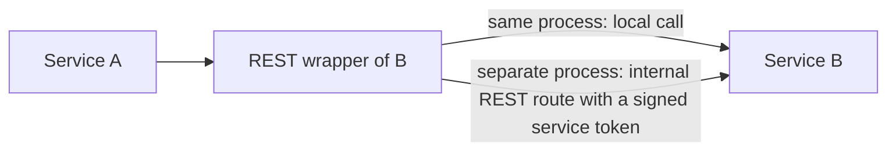
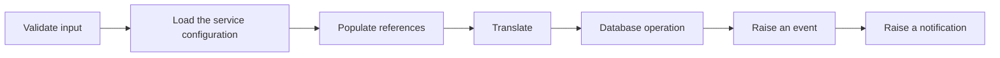

# Design

How the project is built, and how to extend it. For the ideas and the reasons behind them, start with the [project README](../README.md); for the API and the configuration, see the [detailed README](../README.details.md).

## Contents

- [Goals and constraints](#goals-and-constraints)
- [Layers](#layers)
- [Anatomy of a service](#anatomy-of-a-service)
- [Services talking to each other](#services-talking-to-each-other)
- [Start-up and wiring](#start-up-and-wiring)
- [Tenancy in the data](#tenancy-in-the-data)
- [Authorization](#authorization)
- [Writes: the usual sequence](#writes-the-usual-sequence)
- [Extending the project](#extending-the-project)
- [Conventions](#conventions)
- [Placeholders](#placeholders)

## Goals and constraints

- **Many schools, one platform.** Each school is a tenant with its own data. One person can belong to several schools with a different role in each.
- **Security first.** Every request and every service call is authenticated and authorized. The UI never decides.
- **Fast reads.** Lists should be one read. Related data is embedded in the records that show it, and kept current by notifications (or joined on read, per relationship).
- **Small and explicit.** A service is a handful of files with the same shape. The same code runs in one process or several.
- **Closed system.** Nobody signs up. Admins invite.

## Layers

| Layer                                        | Does                                                                                                              | Does not                                                      |
| -------------------------------------------- | ----------------------------------------------------------------------------------------------------------------- | ------------------------------------------------------------- |
| Web server (`src/core/web-server/`)          | Cross-origin rules, security headers, body parsing, builds the request context `req._ctx`                         | Know about any service                                        |
| Auth middleware (`src/services/users-auth/`) | Validates the token, the membership of the tenant, and the role for the exact route                               | Run business rules                                            |
| Router                                       | Lists the routes of one service                                                                                   | Contain logic                                                 |
| Controller                                   | Turns an HTTP request into a service call and the result into an HTTP response                                    | Validate bodies or reach other services                       |
| Service                                      | Validates input (Joi), applies the rules, orchestrates the steps of an operation, raises events and notifications | Build HTTP responses or touch another service's data directly |
| Database module                              | Gives the collection for a tenant and creates its indexes                                                         | Hold business rules                                           |
| REST wrapper (`src/services/rest/`)          | The single way one service calls another                                                                          | Be bypassed                                                   |

## Anatomy of a service

Every domain service has the same files under `src/services/<service>/`:

| File                      | Role                                                                                   |
| ------------------------- | -------------------------------------------------------------------------------------- |
| `<service>.constants.js`  | Paths (`/api/v1/...` and `/api/internal_v1/...`), service names, type, statuses, roles |
| `<service>.router.js`     | The routes                                                                             |
| `<service>.controller.js` | The handlers                                                                           |
| `<service>.service.js`    | Validators, the configuration of references and notifications, and the operations      |
| `<service>.database.js`   | The collection for a tenant, and its indexes                                           |

and a wrapper `src/services/rest/<service>.rest.js` that other services use to call it. The services are: schools, users, users-auth, events, admins, students, professors, classes, locations, groups, and schedules.

## Services talking to each other

A service never imports another service's code or database. It calls the other service's REST wrapper. The wrapper decides how the call travels:

- **Local call:** the wrapper calls the function of service B in the same process. This is the shipped configuration.
- **Internal REST:** the wrapper calls `/api/internal_v1/...` on service B, with a short-lived signed service token and the original request context (user, tenant, request id, language). Internal routes refuse calls without a valid token.

Each wrapper function names the local function to call (`localCall`) and the REST path to use, so moving a service to its own process is configuration, not a rewrite.

## Start-up and wiring

`src/index.js` checks the environment, initialises the translations, and calls `src/services/config.services.js`, which:

1. initialises every service (databases, indexes, providers),
2. subscribes services to each other's notifications,
3. registers the local services and the REST addresses with the communication layer,
4. creates the Portal School if it is missing, and invites the first portal admin if one is configured and none exists yet,

and then the web server starts with the routers from the same file.

## Tenancy in the data

- **Global collections:** schools, users, and users-auth (the memberships are stored in the user).
- **Per-school collections:** admins, students, professors, classes, locations, groups, schedules, and events, named from the service and the tenant (`<service>_<tenantID>`), each with its own indexes.
- The tenant used for a request comes from the **verified** context, never from a value the client chooses freely. A service that works on tenant data refuses a request without one.

## Authorization

`src/services/config.roles.json` lists, for each role, the routes it may call. Besides the roles:

- `all`: routes any logged-in user may call without a school (logout, session, own password).
- `portal-admin`: routes for portal admins, valid only with the Portal School as the tenant.
- `current-user`: routes a person may call on their own record only (the id in the path must be theirs).
- `deny-not-current-school`: routes that are valid only for the selected school itself.

A route that is not listed for the user's role in the selected school is refused.

## Writes: the usual sequence

Most operations follow the same steps, in this order:

Multi-step operations (signup, invite) also define what to undo when a later step fails: signup deletes the school if inviting its first admin fails, and invite deletes the user if the login record cannot be created.

The event names who did it: the logged-in user, or the user of a flow without a login (`setup` at the start, `cleanup pending` for the timers that remove what was not used in time, `anonymous` for a public form). The notification is delivered to each subscriber, whose handler does all the objects of it: a failure of one object is logged, the next objects are still done, the objects whose copies changed are notified again, and the first failure is returned.

## Extending the project

### Add a route

1. Add the route to the service's router and the handler to its controller.
2. Put the logic in the service, with a Joi validator for the input.
3. Add the route to `config.roles.json` for exactly the roles that need it.
4. If other services or the UI call it, add the function to the REST wrapper and to `ui/src/api/api.js`.
5. Add tests (see [testing.md](testing.md)), including the role check.

### Add a service

1. Create the five files above, with the same shape as an existing service, and its REST wrapper.
2. Register it in `config.services.js`: initialisation, the local services, the REST addresses, and the router list.
3. Add its routes to the role matrix, and its tests and the test suite registration.

### Add a relationship (a reference)

1. In the service that stores the copy, add the reference to its configuration: the field, the service it points to, and the projection (the fields to copy).
2. Subscribe it to the other service's notifications in `config.services.js`, with a projection that contains the copied fields.
3. Choose the mode: copy on write with notifications, or join on read. [Data modes](../README.details.md#data-modes-joins-or-notifications) explains both.

### Add a status or a role

Use the constants of the owning service. Do not repeat the literal values in controllers or in the UI when a constant or helper exists.

## Conventions

- Validate in the service, not in the controller. Controllers only translate HTTP.
- Cross a service boundary only through a REST wrapper.
- Keep status and role values in the constants of the owning service.
- Comment boundaries and non-obvious rules with short block comments; separate flows with a comment before each group of statements.
- Keep the UI thin: permissions shown in the UI come from the selected school's roles, and the API is authoritative.
- Translate visible UI text through `ui/src/translations/`.

## Placeholders

These sections will be added.

- **Sequence diagrams per flow** (login, invite, signup, role change, school year): _to be added_.
- **Deployment and operations** (configuration per environment, health checks, monitoring, backups): _to be added_.
- **Data model reference** (every collection with its fields and indexes): _to be added_.
